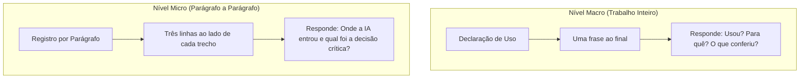
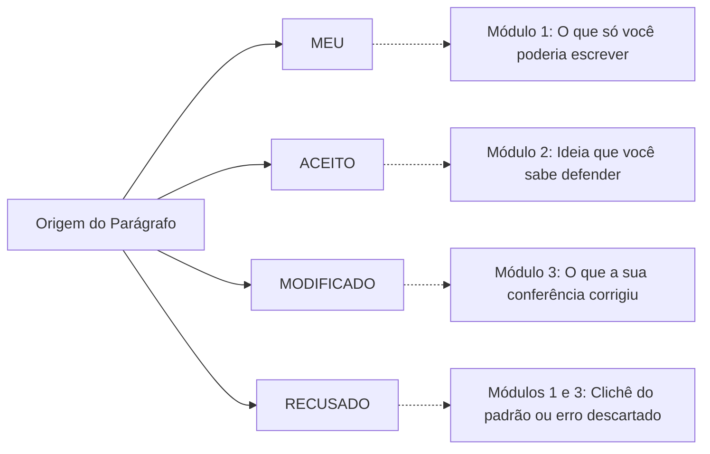
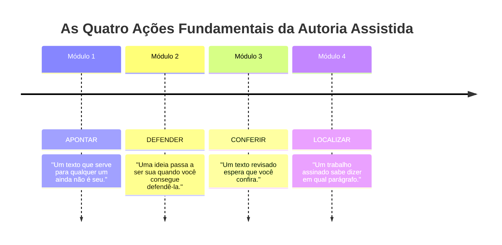

# Material-base: A linha diz que você usou

> **Disciplina:** Inteligência Artificial na Prática Acadêmica e Profissional (COM170)  
> **Quinzena 7 - Módulo 4** | Bimestre: 2026S2B1 - Univesp  
> **Docente Responsável:** Prof. Dr. José Avelino Placca  

---

## 📚 Materiais de Apoio

* **Apostila Oficial:** [COM170_apostila_quinzena7_M4.pdf](file:///home/henrique/Modelos/Univesp/2026S2/COM170-Inteligencia-Artificial-na-Pratica-Academica-e-Profissional/Quinzena-7/Q7-Modulo4/COM170_apostila_quinzena7_M4.pdf) *(Autor: Prof. Dr. José Avelino Placca; Coordenação: Wesley de Souza Lima; Design Instrucional: Claudia Mori; Revisão: Juliana Nascimento Costa e Valteir Vaz; Arte: Henrique Inhauser Caldas)*.
* **E-book Ilustrado:** [Q7_M4-E-book.pdf](file:///home/henrique/Modelos/Univesp/2026S2/COM170-Inteligencia-Artificial-na-Pratica-Academica-e-Profissional/Quinzena-7/Q7-Modulo4/Q7_M4-E-book.pdf).
* **Origem e Evidências:** Base pedagógica da disciplina e do Workshop Fulbright na USP (setembro/2025). Evidências científicas de Brown & Murphy (1989), McCabe, Smith & Parks (2007) e Draxler et al. (2024, *ACM TOCHI*).

---

## 1. 🔍 O que a Declaração Diz e o que Deixa Sem Resposta

Na Quinzena 6, estruturamos a **Declaração de Uso** colocada ao final dos trabalhos:
> *"Neste trabalho, usei uma ferramenta de inteligência artificial para revisar a redação, e li cada parágrafo revisado para conferir se ele ainda dizia o que eu queria dizer."*

Essa declaração atesta que a ferramenta participou e o que foi conferido em nível macro. Contudo, ela deixa sem resposta a pergunta cirúrgica:
> ❓ **"Em qual parágrafo a ferramenta entrou, e o que você decidiu?"**

* **Declaração de Uso:** Fica pública no trabalho entregue.
* **Registro por Parágrafo:** Fica arquivado com o autor (versão de trabalho auditável) para responder prontamente a qualquer questionamento de bancas, professores ou contratantes.

---

## 2. 🧠 A Memória Humana Perde a Origem das Ideias

Por que é mandatório registrar a proveniência no momento em que se escreve, e não no dia da entrega?

### 🔬 O Fenômeno Psicológico da Criptomnésia (Plágio Involuntário)
* **Criptomnésia (*cryptomnesia*):** Do grego "memória oculta". Ocorre quando uma pessoa lembra de uma ideia, palavra ou conceito ouvido anteriormente, mas o cérebro perde a etiqueta de quem a produziu, fazendo a pessoa acreditar genuinamente que a ideia é sua criação original (Brown & Murphy, 1989).
* **O Estudo de McCabe, Smith e Parks (2007):** Em testes laboratoriais com adultos gerando exemplos em grupos, os participantes frequentemente reivindicaram como seus exemplos que haviam sido verbalizados por outros colegas minutos antes. Não houve dolo ou má-fé: **a memória armazena o conteúdo e descarta a fonte**.
* **Alerta do Modo Ciborgue (Quinzena 3):** Quando humano e IA trabalham juntos em simbiose frase a frase, a fronteira de autoria se dissolve em minutos. Sem registro imediato, o autor torna-se incapaz de auditar o próprio texto.

### 🎭 O Efeito Ghostwriter da IA (Draxler et al., 2024)
Em pesquisas experimentais com usuários redigindo textos assistidos por IA publicadas na *ACM TOCHI*, Draxler e colaboradores identificaram três padrões psicológicos:
1. **Sensação de Não-Autoria:** O usuário não se sente internamente "dono" do texto gerado diretamente pela ferramenta.
2. **Omissão Pública da Máquina:** Ao assinar o trabalho publicamente, o usuário tende a omitir a participação da ferramenta, assumindo a autoria solitária.
3. **Influência e Apropriação:** Quanto mais ativamente o usuário edita e intervém no texto, maior é a sua percepção legítima de posse sobre o conteúdo.

> [!WARNING]
> A soma dos dois fenômenos cria um risco crítico: a memória esquece que a frase veio da máquina, e a assinatura isolada mascara a origem do texto.

---

## 3. 🏷️ As Quatro Palavras da Rastreabilidade Textual

Ao lado de cada parágrafo do trabalho, atribui-se uma das quatro palavras de classificação:

1. **`MEU`**: A ferramenta não entrou neste parágrafo. Escrito integralmente pelo autor a partir de suas próprias observações, dados locais ou raciocínio.
2. **`ACEITO`**: A ferramenta escreveu o parágrafo ou sugeriu a ideia, e o texto permaneceu como veio (ou foi parafraseado com a ideia preservada). Exige justificar a apropriação com o teste da defesa.
3. **`MODIFICADO`**: A ferramenta gerou ou revisou, e o autor interveio ativamente (corrigiu números, restaurou grau de certeza prudente ou cortou jargões).
4. **`RECUSADO`**: A ferramenta sugeriu um trecho ou parágrafo e o autor descartou por inconsistência, falsidade ou prolixidade. O leitor final não vê o parágrafo, mas o registro comprova que houve avaliação crítica e leitura prévia.

---

## 4. 📝 O Registro em Três Linhas: Como Fazer na Prática

O registro consiste em três linhas anotadas ao lado de cada parágrafo (usando os comentários do Word, Docs ou anotações em Markdown):

$$\begin{aligned}
\text{Linha 1:} & \quad \textbf{Palavra-chave} \text{ (Meu / Aceito / Modificado / Recusado)} \\
\text{Linha 2:} & \quad \textbf{O pedido exato} \text{ feito à ferramenta (copiado e colado na íntegra)} \\
\text{Linha 3:} & \quad \textbf{O motivo da decisão} \text{ (fundamentado em evidência, conferência ou defesa)}
\end{aligned}$$

---

### 📊 Exemplo Concreto do Material (Trabalho sobre Celular nos Estudos):

| Parágrafo do Trabalho | Palavra | O que você pediu (Prompt) | Motivo da Decisão Registrado | Conexão Metodológica |
| :--- | :---: | :--- | :--- | :--- |
| **Parágrafo 1** *(Levantamento empírico na turma sobre celular)* | **`MEU`** | *Nenhum pedido.* | Dado da minha turma: 23 de 30 colegas deixam o celular ao lado enquanto estudam. | **Módulo 1:** Especificidade empírica que só o autor viveu. |
| **Parágrafo 2** *(Mecanismo: por que notificações atrapalham)* | **`ACEITO`** | *"Explique por que notificações atrapalham a concentração durante o estudo."* | Consigo explicar a razão sem o texto na frente, e conferi a explicação no capítulo indicado pelo professor. | **Módulo 2:** Apropriação crítica (Ideia Defendida). |
| **Parágrafo 3** *(Impacto de colocar o celular em outro cômodo)* | **`MODIFICADO`** | *"Revise a redação deste parágrafo sem mudar o conteúdo."* | A revisão trocou "pode ajudar" por "ajuda". Devolvi o grau de certeza original, porque 30 colegas não permitem afirmar mais. | **Módulo 3:** Auditoria de revisão e restauração do grau de certeza. |
| **Parágrafo 4** *(Conclusão do estudo)* | **`RECUSADO`** | *"Escreva uma conclusão para o trabalho."* | A conclusão servia para qualquer trabalho: tinha elogio vazio e uma lista de três palavras abstratas. Escrevi outra. | **Módulo 1:** Rejeição dos três sinais do padrão genérico. |

> [!TIP]
> **Como Operacionalizar:**  
> Insira como comentários no arquivo de trabalho durante a escrita. Guarde uma cópia com os comentários para sua guarda técnica e, se a instituição exigir texto limpo, gere um PDF final sem marcas visíveis. Se a rubrica de avaliação checar uso crítico, um registro apenas com *"Aceito"* sem justificativas revela subserviência acrítica; a presença de *"Modificado"* e *"Recusado"* comprova autoria plena.

---

## 5. 🛡️ Quem Lê Isto e Age a Partir Disto?

A Bússola Ética da Quinzena 6 foca no impacto sobre os **afetados**. No contexto da autoria textual:
* O professor lê e atribui uma nota ou aprovação.
* O colega lê e baseia sua própria pesquisa em dados seus.
* O gestor ou engenheiro lê e toma decisões financeiras, operacionais ou estruturais de risco.

### ⚠️ O Escândalo da Universidade de Hong Kong (Outubro–Dezembro/2025):
* Artigo publicado na revista *China Population and Development Studies* sobre 40 anos de natalidade em Hong Kong.
* Um aluno de doutorado gerou referências bibliográficas via IA sem checagem. As fontes eram alucinações completas.
* O artigo foi retratado. O professor orientador (autor correspondente) perdeu o cargo de vice-decano, afastou-se de comitês de pesquisa e ambos foram punidos.
* **Lição Inegociável:** Todos os signatários respondem solidariamente. A autoria assistida exige responsabilidade integral sobre cada parágrafo assinado.

---

## 🏛️ Síntese Geral da Quinzena 7: Os Quatro Pilares da Autoria

---

## 📌 Referências Bibliográficas

* **BROWN, A. S.; MURPHY, D. R.** Cryptomnesia: delineating inadvertent plagiarism. *Journal of Experimental Psychology: Learning, Memory, and Cognition*, v. 15, n. 3, p. 432-442, 1989. DOI: [10.1037/0278-7393.15.3.432](https://doi.org/10.1037/0278-7393.15.3.432).
* **DRAXLER, F.; WERNER, A.; LEHMANN, F.; HOPPE, M.; SCHMIDT, A.; BUSCHEK, D.; WELSCH, R.** The AI ghostwriter effect: when users do not perceive ownership of AI-generated text but self-declare as authors. *ACM Transactions on Computer-Human Interaction (TOCHI)*, v. 31, n. 2, art. 25, 2024. DOI: [10.1145/3637875](https://doi.org/10.1145/3637875). Versão aberta: [arXiv:2303.03283](https://arxiv.org/abs/2303.03283).
* **McCABE, D. P.; SMITH, A. D.; PARKS, C. M.** Inadvertent plagiarism in young and older adults: the role of working memory capacity in reducing memory errors. *Memory & Cognition*, v. 35, n. 2, p. 231-241, 2007. DOI: [10.3758/BF03193444](https://doi.org/10.3758/BF03193444).
