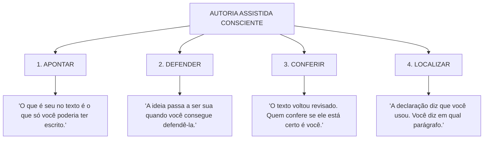

# Miniquiz: Quatro gestos, seis situações

> **Disciplina:** Inteligência Artificial na Prática Acadêmica e Profissional (COM170)  
> **Quinzena 7 - Módulo 4** | Bimestre: 2026S2B1 - Univesp  
> **Natureza:** Peça-fechadura da disciplina (Simulado no formato da avaliação oficial)  

---

## 📌 Apresentação do Miniquiz

O miniquiz reúne as quatro ações práticas fundamentais trabalhadas ao longo de toda a Quinzena 7:
1. **Apontar o padrão:** Reconhecer os três sinais do texto genérico (*Módulo 1*).
2. **Defender a ideia:** Apresentar a razão de fora da frase e responder a contraposições (*Módulo 2*).
3. **Conferir a revisão:** Auditar o que a ferramenta corrigiu, o que deixou passar e preservar o grau de certeza (*Módulo 3*).
4. **Localizar o parágrafo:** Construir a matriz de rastreabilidade textual com as quatro palavras (*Módulo 4*).

São **seis situações reais** com 5 alternativas cada, projetadas no formato exato da prova presencial da Univesp.

---

## 📌 Situação 1 de 6: Os Sinais do Padrão e os Detectores de IA

* **Caso:** Lara redigiu sua resenha sem IA, mas terminou com fórmula genérica (*"relevância, atualidade e pertinência"*), obtendo 81% no detector de IA. Hugo usou IA, mas forneceu dados detalhados com páginas e citações, obtendo 9% no detector. A professora presumiu que a concordância entre detector e clichês provava o uso de IA por Lara.
* **Pergunta:** *Qual crítica aponta a falha mais grave do raciocínio da professora?*
* **Gabarito e Justificativa:**
  > O programa detector e os sinais do padrão avaliam apenas **traços da superfície do texto** (o estilo estatístico médio), que podem ser produzidos tanto por estudantes quanto por máquinas. Nenhum dos dois analisa o **processo real de autoria** (histórico de versões, anotações e explicação do autor). Com dados próprios, o texto gerado por IA sai sem o padrão; e humanos sem IA frequentemente recorrem a clichês genéricos.

---

## 📌 Situação 2 de 6: Apropriação Crítica e Afirmação Menor

* **Caso:** Uma IA sugeriu a Paula: *"Oferecer desconto no primeiro pedido aumenta a fidelidade dos clientes"*. Paula testou 10% de desconto em março vs. fevereiro sem desconto:
  * *Fevereiro:* 120 novos clientes $\rightarrow$ 36 fizeram 2º pedido (taxa de 30%).
  * *Março:* 200 novos clientes $\rightarrow$ 36 fizeram 2º pedido (taxa de 18%).
* **Pergunta:** *Considerando apenas os dados apresentados, qual conclusão Paula pode defender?*
* **Gabarito e Justificativa:**
  > Paula pode defender uma **afirmação menor**: o desconto atraiu mais clientes novos (aumento de 80 clientes no 1º pedido), mas os dados não comprovam aumento da fidelidade (os mesmos 36 voltaram). A hipótese ampla sobre fidelidade deve permanecer em aberto para testes longitudinais com contagem controlada.

---

## 📌 Situação 3 de 6: A Ilusão de Autonomia do Prompt de Revisão

* **Caso:** Rodrigo ouviu de um colega que, estruturando o prompt nos quatro componentes e incluindo a restrição *"mantenha todos os números como estão"*, a ferramenta encontraria os erros de inglês sem alterar os dados, dispensando a necessidade de conferir o relatório depois.
* **Pergunta:** *Qual crítica aponta a falha mais grave do argumento do colega?*
* **Gabarito e Justificativa:**
  > A restrição protege os números contra alterações arbitrárias da IA, mas **não valida se os números redigidos estavam corretos na origem** nem se as conclusões combinam com os resultados da planilha. A ferramenta não tem os dados primários e atua exclusivamente na língua. Um pedido estruturado potencializa a revisão formal, mas a **conferência fática permanece indelegável ao autor**.

---

## 📌 Situação 4 de 6: Critérios de Classificação na Matriz de Rastreabilidade

* **Caso:** Sabrina registrou o Parágrafo 4 como: *Meu. Pedido: "escreva uma conclusão a partir dos parágrafos anteriores". Motivo: mudei três palavras para ficar no meu estilo.*
* **Pergunta:** *Qual linha do registro precisa ser corrigida, e por quê?*
* **Gabarito e Justificativa:**
  > A linha do **Parágrafo 4** está incorreta. Como a ferramenta redigiu o parágrafo e Sabrina apenas alterou três palavras, a classificação técnica correta é **`MODIFICADO`** (e não `MEU`). A etiqueta reflete a origem real do trecho e o que a IA fez, e não quem realizou o último retoque cosmético. Ademais, *"ficar no meu estilo"* é uma justificativa vaga e não auditável.

---

## 📌 Situação 5 de 6: Criptomnésia e o Risco do Registro Tardio

* **Caso:** Thiago redigiu um trabalho ao longo de três semanas. Declarou uso de IA, mas preencheu o registro por parágrafo **de memória no dia da entrega**, marcando *Meu* em cinco de seis parágrafos. O histórico da ferramenta provou que os parágrafos 2 e 5 foram gerados pela máquina e posteriormente editados.
* **Pergunta:** *Considerando o que a situação descreve, qual é a explicação mais provável para a diferença entre o registro e o histórico?*
* **Gabarito e Justificativa:**
  > Trata-se do fenômeno psicológico do **plágio involuntário (criptomnésia)**: com o passar das semanas, a memória retém o texto e as ideias, mas descarta a etiqueta da fonte (quem produziu), fazendo o autor acreditar genuinamente que escreveu tudo sozinho, sem dolo de copiar. A solução técnica obrigatória é **preencher o registro no mesmo dia**, no próprio documento.

---

## 📌 Situação 6 de 6: A Pergunta Ética e a Priorização da Auditoria

* **Caso:** Aline enviará relatório à prefeitura recomendando a instalação de dois novos pontos de coleta. O Parágrafo 4 (`Aceito`) traz uma ordenação quantitativa gerada pela IA ponderando as visitas de Aline e a população dos seis bairros. Aline tem apenas uma hora antes do envio final.
* **Pergunta:** *Considerando quem vai ler o relatório e o que vai fazer com ele, qual é o uso mais adequado dessa hora?*
* **Gabarito e Justificativa:**
  > O uso prioritário é **refazer os cálculos e recalcular a ordem dos bairros manualmente na planilha**. A prefeitura alocará recursos públicos e construirá os pontos com base estrita no ranking do Parágrafo 4. Modelos de IA frequentemente cometem erros de cálculo, proporção e ordenamento numérico. Como quem lê agirá diretamente com base nessa ordem, validar a matemática é a ação crítica de proteção dos afetados.

---

## 📌 Passo 8 de 8: A Síntese da Quinzena 7 — Os Quatro Gestos da Autoria

---

### 💬 Pergunta Orientadora para a Próxima Quinzena (Revisão da Disciplina):
> *"De tudo o que você aprendeu aqui, o que fica como o seu jeito de trabalhar?"*

---

> ✅ **Status da Atividade:** Miniquiz concluído com 100% de aproveitamento na plataforma AVA da Univesp. Fechadura do Módulo 4 concluída!
