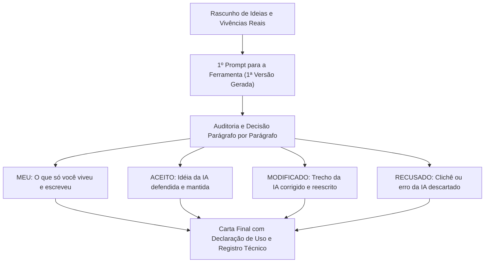

# Q7 M5 - O trabalho da quinzena: A carta para quem começa

> **Disciplina:** Inteligência Artificial na Prática Acadêmica e Profissional (COM170)  
> **Quinzena 7 - Módulo 5** | Bimestre: 2026S2B1 - Univesp  
> **Docente Responsável:** Prof. Dr. José Avelino Placca  

---

## 💬 Apresentação do Trabalho Final

Daqui a um ano, uma pessoa vai abrir esta disciplina pela primeira vez. Ela vai ver os módulos, o Laboratório, o grupo, as lives, e vai ter as mesmas perguntas que você teve na primeira semana. **Você sabe hoje o que ela ainda não sabe.**

Nesta quinzena você aprendeu quatro gestos para escrever com uma ferramenta de inteligência artificial:
1. **Apontar o padrão** num texto pronto.
2. **Defender uma ideia** que veio da ferramenta.
3. **Conferir um texto** que voltou revisado.
4. **Localizar e dizer, parágrafo por parágrafo,** em qual deles a ferramenta escreveu.

Agora você vai usar os quatro gestos num texto seu, do começo ao fim.

---

## 🎯 O Trabalho: A Carta de Orientação

Você vai escrever, com a ferramenta que preferir (ChatGPT, Gemini ou Copilot), uma **carta de quatro a seis parágrafos** para essa pessoa que ingressará no curso no ano que vem, ajudando-a a se orientar na disciplina:

* **Estrutura:** 4 a 6 parágrafos.
* **Destinatário Real:** Um calouro da Univesp que passará pela mesma jornada.
* **Rastreabilidade Obrigatória:** Cada parágrafo deve ser acompanhado de uma das quatro palavras (**`MEU`**, **`ACEITO`**, **`MODIFICADO`**, **`RECUSADO`**) e o motivo da decisão.
* **Declaração de Uso:** Ao final da carta, contendo o nome da ferramenta e a versão exata do modelo.

---

## 🗓️ O Fluxo dos Módulos Práticos (M5, M6 e M7)

| Módulo | O que você faz | O que entrega e onde |
| :--- | :--- | :--- |
| **Módulo 5** | Leitura das orientações gerais e escolha da ferramenta (ChatGPT / Gemini / Copilot) com registro do modelo. | **Nada a entregar** neste módulo. |
| **Módulo 6** | Segue o guia do portfólio individual: 4 passos com a IA, ficha de resultados e defesa escrita de um parágrafo da carta. | Documento completo com os 4 passos, ficha e defesa no **Laboratório de Revisão do Módulo 6** + peer review de um colega. |
| **Módulo 7** | Trabalho em Grupo: comparação das fichas, montagem do Mapa dos Conselhos com origem de cada um e resposta a 3 perguntas. | Mapa e 3 respostas enviados pelo representante no **Laboratório de Revisão do Módulo 7** + feedback a grupo parceiro. |

---

## 🛠️ Ferramenta Escolhida para o Trabalho

* **Ferramenta:** Google Gemini / ChatGPT / Microsoft Copilot
* **Modelo em uso:** (Ex.: Gemini 2.5 Flash / Claude 3.5 Sonnet / GPT-4o)
