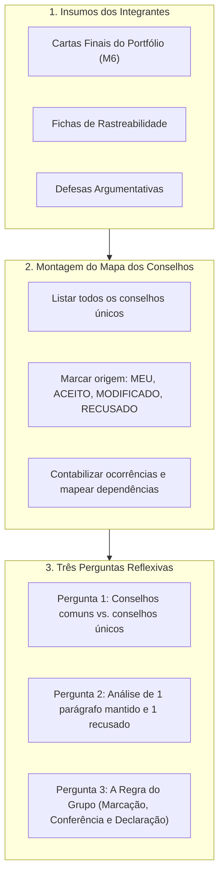

# Módulo 7: Guia do Trabalho de Grupo (O Mapa dos Conselhos)

> **Disciplina:** Inteligência Artificial na Prática Acadêmica e Profissional (COM170)  
> **Quinzena 7 - Módulo 7** | Bimestre: 2026S2B1 - Univesp  
> **Prazo de Envio:** De 19 de outubro (Segunda) a 24 de outubro de 2026 (Sábado), às 23h59  
> **Local de Envio:** Laboratório de Revisão do Módulo 7 (enviado pelo representante do grupo)  
> **Revisão entre Pares:** De 25 de outubro (Domingo) a 27 de outubro (Terça), às 23h59  
> **Anonimato Obrigatório:** Documento sem nomes pessoais ou número de grupo.

---

## 🗺️ O Trabalho do Grupo, em Poucas Palavras

Cada pessoa do grupo escreveu uma carta para quem vai começar o curso no ano que vem. Agora o grupo junta as cartas e monta o **Mapa dos Conselhos**: uma tabela (ou diagrama) com todos os conselhos das cartas e a origem de cada um (da experiência de vocês ou da ferramenta). Depois, o grupo responde a três perguntas analíticas sobre o que o mapa revela.

---

## 📋 As Quatro Palavras de Origem no Mapa

| Palavra | Quando Usar | Como Escrever no Mapa |
| :--- | :--- | :--- |
| **`MEU`** | O conselho está num parágrafo autoral de pelo menos uma carta. Anota-se de qual quinzena veio a experiência. | `MEU · X cartas · quinzena Y` |
| **`ACEITO`** | A ferramenta escreveu o conselho, e os integrantes mantiveram o texto como estava. | `ACEITO · X cartas` |
| **`MODIFICADO`** | A ferramenta escreveu o conselho, e alguém mudou o texto. Anota-se em poucas palavras o que mudou. | `MODIFICADO · X cartas · motivo da alteração` |
| **`RECUSADO`** | A ferramenta escreveu o conselho, e alguém o tirou da carta. O conselho entra riscado com o motivo. | `RECUSADO · X cartas · motivo do descarte` |

---

## 👤 Se Você Estiver Sozinho no Grupo

O guia oficial da Univesp estabelece explicitamente:
> *"Monte o mapa com a sua própria carta: em cada conselho, o número de cartas é 1. Os conselhos recusados vêm do seu registro. Responda às três perguntas na primeira pessoa. Na pergunta 1, compare a carta da ferramenta com a sua carta final. Na pergunta 2, use a sua defesa. Na pergunta 3, escreva a sua regra para os próximos trabalhos. Envie como representante do seu grupo. O trabalho vale por inteiro."*

---

## 🎯 Rubrica Oficial de Avaliação (Nível Consolidado)

1. **Mapa com origens:** Cada conselho tem a palavra de origem e o número de cartas, e há pelo menos um conselho `MODIFICADO` ou `RECUSADO` com o motivo.
2. **Respostas com exemplos do grupo:** As três respostas citam as fichas ou as defesas, e a pergunta 2 traz um parágrafo mantido e um recusado, com o motivo de cada um.
3. **Regra do grupo:** A regra diz como o grupo marca, quem confere e como declara o uso de IA, e explica o porquê conectando com algo que aconteceu nas cartas.
