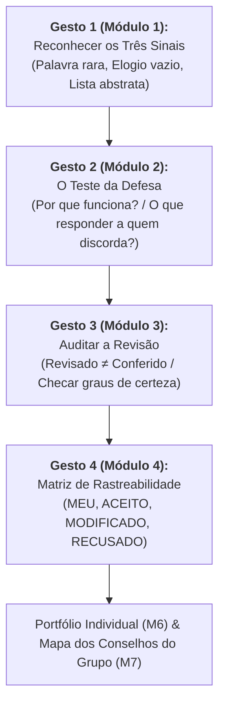

# 🎯 Módulo 7 — Em Síntese: O que você leva desta Quinzena

> **Disciplina:** Inteligência Artificial na Prática Acadêmica e Profissional (COM170)  
> **Quinzena 7 - Módulo 7** | Bimestre: 2026S2B1 - Univesp  
> **Status:** 🟢 **Quinzena 7 Concluída com Êxito**  

---

## 👩‍🏫 Mensagem Oficial de Fechamento do AVA

### 💬 O que você leva desta quinzena

Quinze dias atrás, a pergunta era o que faz um texto escrito com a ferramenta ser seu. Você respondeu a ela com **quatro gestos**, um por módulo, e eles servem para qualquer texto que você escrever daqui em diante:

1. **Os Três Sinais do Padrão:** Para apontar num texto pronto, sabendo que um sinal mostra o padrão sem provar quem escreveu, mesmo quando um programa detector apresenta uma porcentagem estatística.
2. **O Teste da Defesa:** Com as duas perguntas que dizem se uma ideia já é sua (explicar com as próprias palavras por que funciona e o que responder a quem discorda).
3. **Auditoria de Texto Revisado:** As três perguntas para conferir um texto que voltou da ferramenta e a técnica de instrução que direciona o olhar do revisor.
4. **As Quatro Palavras de Origem:** **`Meu`**, **`Aceito`**, **`Modificado`** e **`Recusado`**, integradas ao registro técnico que documenta o motivo de cada decisão editorial.

No caminho, você ajudou colegas da turma com os textos deles e, no portfólio, usou os quatro gestos num texto seu, do primeiro ao último passo. Na carta que você escreveu para quem começa, você sabe dizer de onde veio cada parágrafo. No grupo, o mapa mostrou quais conselhos a ferramenta escreve para todos e quais só a experiência de cada pessoa consegue dar. 

> [!IMPORTANT]
> **Guarde a regra do grupo:** ela vale para os próximos trabalhos em equipe, nesta e nas outras disciplinas do curso de Engenharia da Computação!

---

## 🗺️ Mapa Integrado dos 4 Gestos de Autoria Assistida

---

## 🔮 Na Próxima Quinzena: A Reta Final

> ### 📚 Quinzena 8: Revisão Geral para a Prova Final
> A **Quinzena 8 é a última da disciplina e prepara você para a prova**. Ela retoma, quinzena por quinzena, todos os conceitos que a avaliação oficial cobra:
> * Os limites computacionais dos LLMs (predição estocástica de tokens);
> * Vieses históricos e alucinações;
> * Modos de trabalho Centauro e Ciborgue;
> * Engenharia de Prompt (Papel, Objetivo, Restrições e Formato);
> * Leitura crítica de artigos científicos e checagem factual;
> * Decisões algorítmicas, variáveis *proxy* e governança ética;
> * Autoria assistida consciente e declaração de uso.
> 
> Ela termina com uma reflexão definitiva sobre você: **de tudo o que você aprendeu aqui, o que fica como o seu jeito próprio de trabalhar?**
