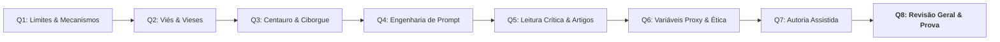

# 🤖 Quinzena 7 — Autoria Assistida

> **Disciplina:** Inteligência Artificial na Prática Acadêmica e Profissional (`COM170`)  
> **Docente Responsável:** Prof. Dr. José Avelino Placca  
> **Bimestre:** 2026S2B1 — Univesp  
> **Status:** 🟢 **Quinzena Concluída com Êxito**  

---

## 📁 Estrutura de Módulos da Quinzena 7

| Módulo / Arquivo | Descrição | Status |
| :--- | :--- | :---: |
| [**`0-Introducao.md`**](file:///home/henrique/Modelos/Univesp/2026S2/COM170-Inteligencia-Artificial-na-Pratica-Academica-e-Profissional/Quinzena-7/0-Introducao.md) | Apresentação oficial da quinzena e os 5 objetivos pedagógicos de autoria assistida | 🟢 Pronto |
| [**`Q7-Modulo1/`**](file:///home/henrique/Modelos/Univesp/2026S2/COM170-Inteligencia-Artificial-na-Pratica-Academica-e-Profissional/Quinzena-7/Q7-Modulo1/) | **O texto que serve para qualquer um:** Os três sinais de texto gerado por IA (palavra rara, elogio vazio e enumerações abstratas) e atividade interativa | 🟢 Pronto |
| [**`Q7-Modulo2/`**](file:///home/henrique/Modelos/Univesp/2026S2/COM170-Inteligencia-Artificial-na-Pratica-Academica-e-Profissional/Quinzena-7/Q7-Modulo2/) | **O argumento que você não tinha:** O teste da defesa de ideias da máquina (*por que funciona? / o que responder a quem discorda?*) | 🟢 Pronto |
| [**`Q7-Modulo3/`**](file:///home/henrique/Modelos/Univesp/2026S2/COM170-Inteligencia-Artificial-na-Pratica-Academica-e-Profissional/Quinzena-7/Q7-Modulo3/) | **O texto voltou revisado:** Auditoria crítica de textos revisados ou traduzidos por IA (*revisado $\neq$ conferido*) e alteração de graus de certeza | 🟢 Pronto |
| [**`Q7-Modulo4/`**](file:///home/henrique/Modelos/Univesp/2026S2/COM170-Inteligencia-Artificial-na-Pratica-Academica-e-Profissional/Quinzena-7/Q7-Modulo4/) | **A linha diz que você usou:** A matriz de rastreabilidade textual por parágrafo (**`Meu`**, **`Aceito`**, **`Modificado`** e **`Recusado`**) e miniquiz | 🟢 Pronto |
| [**`Q7-Modulo5/`**](file:///home/henrique/Modelos/Univesp/2026S2/COM170-Inteligencia-Artificial-na-Pratica-Academica-e-Profissional/Quinzena-7/Q7-Modulo5/) | **O trabalho da quinzena:** Orientações gerais da "Carta para quem começa" e templates oficiais em `.docx` | 🟢 Pronto |
| [**`Q7-Modulo6/`**](file:///home/henrique/Modelos/Univesp/2026S2/COM170-Inteligencia-Artificial-na-Pratica-Academica-e-Profissional/Quinzena-7/Q7-Modulo6/) | **Portfólio Individual:** Resolução completa em 6 passos, carta final revisada, ficha de resultados, defesa argumentativa de 15 linhas e arquivo `.docx` | 🟢 Pronto |
| [**`Q7-Modulo7/`**](file:///home/henrique/Modelos/Univesp/2026S2/COM170-Inteligencia-Artificial-na-Pratica-Academica-e-Profissional/Quinzena-7/Q7-Modulo7/) | **Trabalho em Grupo (O Mapa dos Conselhos) & Em Síntese:** Tabela com origens e dependências, respostas às 3 perguntas reflexivas (A Regra do Grupo) e fechamento oficial | 🟢 Pronto |

---

## 🧭 Relação das Quinzenas de COM170

