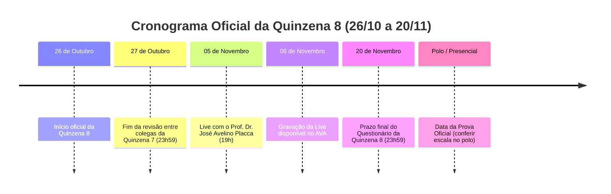

# 📅 Datas e Cronograma da Quinzena 8

> **Disciplina:** Inteligência Artificial na Prática Acadêmica e Profissional (`COM170`)  
> **Docente Responsável:** Prof. Dr. José Avelino Placca  
> **Período da Quinzena:** 26 de outubro a 20 de novembro de 2026  
> **Bimestre:** 2026S2B1 — Univesp  

---

## ⏰ Calendário Geral e Prazos

Todos os prazos no AVA encerram impreterivelmente às **23h59** do dia indicado.

---

## 📌 Detalhamento dos Marcos

| Data | Dia da Semana | Atividade / Evento | Descrição e Observações |
| :--- | :---: | :--- | :--- |
| **26/10** | Segunda-feira | **Início da Quinzena 8** | Abertura dos conteúdos de revisão e questionário final no AVA. |
| **27/10** | Terça-feira | **Fim da Revisão da Q7** | Prazo final para envio da avaliação por pares do Portfólio Individual e Trabalho em Grupo da Quinzena 7. |
| **05/11** | Quinta-feira | **Live do Prof. Placca (19h)** | Live de revisão e orientações da reta final. Link divulgado no Fórum de Notícias. |
| **06/11** | Sexta-feira | **Gravação da Live no AVA** | Disponibilização do vídeo para quem não puder acompanhar ao vivo. |
| **20/11** | Sexta-feira | **Fechamento do Questionário** | **Último dia do questionário da Q8** (encerramento do ciclo formativo no AVA às 23h59). |
| *A conferir* | — | **Prova Oficial Presencial** | Consultar a data e horário agendados no sistema da Univesp / escala do polo. |

---

> [!IMPORTANT]
> **Atenção à Revisão entre Colegas da Quinzena 7:**  
> A fase de avaliação às cegas da Quinzena 7 encerra amanhã, **terça-feira, 27 de outubro, às 23h59**. Certifique-se de que seus feedbacks foram enviados para garantir a nota integral do Laboratório de Revisão da Q7.
