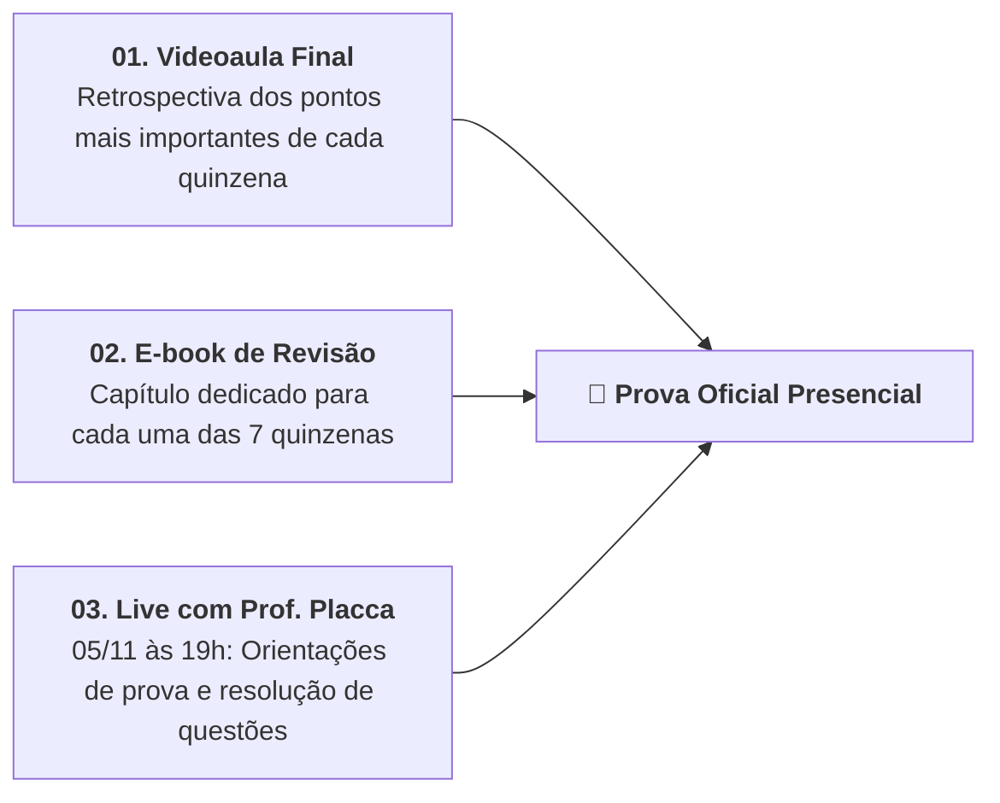

# 🎓 Introdução à Quinzena 8 — Revisão e Preparação para a Prova

> **Docente Responsável:** Prof. Dr. José Avelino Placca  
> **Disciplina:** Inteligência Artificial na Prática Acadêmica e Profissional (`COM170`)  
> **Quinzena 8** | Bimestre: 2026S2B1 — Univesp  

---

## 💬 Mensagem do Professor Dr. José Avelino Placca

> *"Olá, boas-vindas à oitava e última quinzena!"*

Lembram da pergunta que abriu a disciplina? **O que é, afinal, inteligência artificial?** Hoje vocês conseguem responder com muito mais precisão do que no primeiro dia:

* **Mecanismos e Limites:** Vocês viram como um modelo de linguagem transforma texto em números (tokens/vetores) e calcula probabilisticamente a próxima palavra, por que ele pode errar com tanta segurança (alucinação) e quanto custa, em energia e em trabalho humano invisível, cada resposta que aparece na tela.
* **Do Olhar para a Ação:**
  * Identificaram as competências cognitivas e profissionais que mudam com a IA;
  * Organizaram o contexto rigoroso de uma instrução (Engenharia de Prompt);
  * Conferiram citações e referências diretamente na fonte original primária;
  * Aplicaram a **Bússola de Decisão Ética** (*Quem*, *Sabe*, *Responde*, *Custa*);
  * Na Quinzena 7, escreveram com a ferramenta sabendo apontar com clareza **qual parte do texto é de vocês** (matriz de rastreabilidade: *Meu*, *Aceito*, *Modificado* e *Recusado*).

---

## 🏛️ O Modelo Inovador da Disciplina Estruturante

Esta foi a **primeira disciplina estruturante da história da Univesp**, e vocês foram a primeira turma a percorrer essa metodologia ativa:
* Módulos abertos em sequência lógica com peças-fechadura;
* Grupos colaborativos de cinco pessoas;
* Revisão às cegas entre pares no Laboratório de Avaliação;
* Lives interativas em todas as quinzenas;
* Prova presencial nos polos.

Muitos dos ajustes feitos ao longo do semestre foram fruto direto das dúvidas, comentários e apontamentos trazidos por vocês através dos facilitadores, supervisores e fóruns.

---

## 📚 Os Três Materiais de Preparação da Quinzena 8

1. **`01` | Videoaula Final:** Em que o professor Placca retoma de forma sintética e conectada o essencial de cada quinzena.
2. **`02` | E-book de Revisão:** Material teórico estruturado com um capítulo analítico por quinzena.
3. **`03` | Live do Professor Placca (05/11 às 19h):** Encontro focado exclusivamente no formato da prova, com resolução de questões comentadas ao vivo. *(Gravação disponível no AVA em 06/11)*.

---

## 📋 Ações e Atividades da Quinzena

* [ ] **Fórum de Dúvidas:** Canal aberto com os facilitadores para esclarecimento de conceitos e questões teóricas.
* [ ] **Questionário Avaliativo "Conte para nós":** Pesquisa de percepção institucional sobre a experiência pedagógica e as ferramentas da disciplina.
* [ ] **Questionário da Quinzena 8:** Fechamento e consolidação das notas no AVA (prazo final: **20 de novembro às 23h59**).
