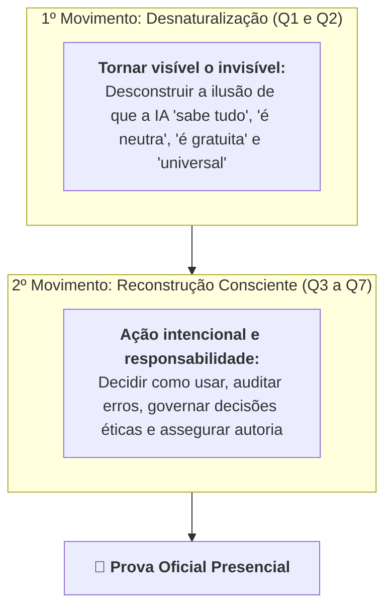
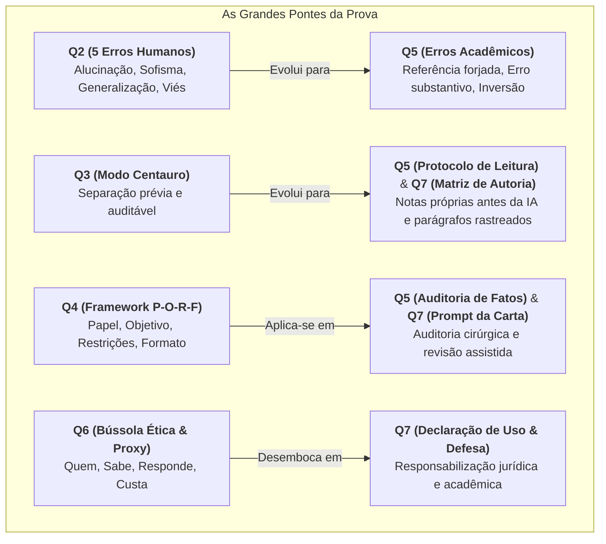

# 🎥 Videoaula de Revisão Geral — O Mapa Completo para a Prova

> **Disciplina:** Inteligência Artificial na Prática Acadêmica e Profissional (`COM170`)  
> **Docente Responsável:** Prof. Dr. José Avelino Placca  
> **Link Oficial:** [YouTube - Videoaula de Revisão COM170](https://www.youtube.com/watch?v=33XXzjVdJCg)  
> **Quinzena 8** | Bimestre: 2026S2B1 — Univesp  

---

## 🧭 Os Dois Grandes Movimentos da Disciplina

A disciplina foi desenhada em uma ordem pedagógica intencional: **quem aprende a técnica antes de desnaturalizar a ferramenta, aprende a pedir melhor, mas continua operando no piloto automático**. Por isso, o percurso seguiu o fluxo: **Ver $\to$ Decidir $\to$ Julgar $\to$ Responder**.

| Ilusão Naturalizada | Realidade Desvelada pela Disciplina |
| :--- | :--- |
| *"A IA sabe a resposta verdadeira"* | O modelo apenas calcula estatisticamente a sequência de tokens mais provável. |
| *"A ferramenta é neutra e imparcial"* | Herda e amplifica os vieses dos dados históricos gerados por humanos. |
| *"O serviço na tela é de graça"* | Consome energia, água para resfriamento de data centers e depende de trabalho humano precarizado (*trabalho fantasma* de rotulagem e moderação). |
| *"Funciona igual no mundo todo"* | Ilusão de universalidade: bases de treino como GPT-3 possuem mais de 90% dos dados em inglês, sub-representando realidades locais e regionais brasileiras. |

---

## 🔍 Retrospectiva Quinzena a Quinzena com Foco na Prova

### 📌 Quinzena 1: O que é, afinal, Inteligência Artificial?
* **Definição Operacional:** Sistema que **percebe** o ambiente, **processa** a informação e **age** para alcançar um **objetivo definido por humanos** (ex.: algoritmo de recomendação de vídeos cujo objetivo é maximizar o tempo de retenção).
* **Três Formas de Aprendizado de Máquina:**
  1. *Supervisionado (com gabarito):* Cada dado de entrada vem com a resposta correta rotulada (ex.: filtro de spam).
  2. *Não Supervisionado (sem legenda):* O sistema agrupa e identifica padrões sozinho por similaridade matemática.
  3. *Por Reforço (tentativa e recompensa):* O modelo aprende interagindo por ensaio e erro bonificado.
* **Custos Ocultos:**
  * *Treinamento:* Ocorre uma vez e consome montantes massivos de energia e água.
  * *Inferência (Uso):* Ocorre a cada consulta enviada por milhões de usuários.
  * *Trabalho Fantasma:* Trabalhadores invisíveis e sub-remunerados no Sul Global responsáveis por rotular dados e limpar conteúdo tóxico.

---

### 📌 Quinzena 2: O que acontece quando você aperta Enter?
* **O Pipeline Técnico dos LLMs:**  
  $$\text{Texto} \xrightarrow{\text{Tokenização}} \text{Tokens (números)} \xrightarrow{\text{Embeddings/Atenção}} \text{Cálculo Probabilístico} \xrightarrow{\text{Temperatura/Amostragem}} \text{Texto Final}$$
* **A Origem da Alucinação:** A alucinação não é uma falha pontual, mas nasce da mesma conta probabilística que gera respostas corretas. O modelo busca plausibilidade e fluência, não verdade factual.
* **Os 5 Tipos de Erro (e seus arquétipos humanos):**
  1. **Alucinação Factual (*O Blefe*):** Afirma com convicção absoluta dados que não existem.
  2. **Viés de Corpus (*O Preconceito Automático*):** Reprodução de estereótipos presentes nos textos de treinamento.
  3. **Vagueza Confortável (*A Evasão*):** Resposta genérica e protocolar (*"cada caso é um caso"*) que não responde ao cerne.
  4. **Coerência sem Verdade (*O Sofisma*):** Estrutura lógica perfeita e articulada construída sobre premissas falsas.
  5. **Ausência de Contexto (*A Generalização*):** Aplica regras gerais ignorando as particularidades da situação concreta.
* **RLHF (Reinforcement Learning from Human Feedback):** Ajuste fino com avaliadores humanos. O assistente aprende a soar cortês e agradável, priorizando a aceitabilidade social em detrimento da exatidão factual.

---

### 📌 Quinzena 3: Competências e Modos de Trabalho
* **Taxonomia das Competências (Bailey e Barley / Macoin):**
  * **Duradouras (*Enduring*):** Continuam exclusivamente humanas e tornam-se mais vitais (auditar, defender ideias em reuniões, responder pelos impactos).
  * **Que mudam de forma (*Evolving*):** Continuam sendo feitas por você, mas executadas com apoio da máquina (ex.: redação de relatórios técnicos).
  * **Emergentes (*Emerging*):** Surgiram justamente pela existência da IA (auditoria algorítmica, engenharia de prompt).
  * **Em declínio (*Diminishing*):** Execuções manuais repetitivas delegadas à máquina.
  * ⚠️ *Atenção de Prova:* Não classifique por emoção (nem considerar tudo em extinção por ansiedade, nem achar que nada muda por negação).
* **Modos de Interação:**
  * **Modo Centauro:** Divisão estrita e prévia das tarefas (o que é seu vs. o que é da máquina). **Já nasce auditável**.
  * **Modo Ciborgue:** Fusão contínua e colaborativa durante a execução frase a frase.
* **As 3 Perguntas Antes de Ler a Resposta:**
  1. *Eu tenho conhecimento prévio para perceber se a IA errou?*
  2. *Fazer essa tarefa sozinho me ensina algo indispensável?*
  3. *A tarefa envolve regra local, recente ou específica da minha instituição?*

---

### 📌 Quinzena 4: Engenharia de Prompt e Limites do Modelo
* **A Janela de Contexto:** O modelo lê a pilha inteira (instruções do sistema + histórico da conversa + documentos anexados + seu prompt na última linha).
* **O Framework P-O-R-F:**
  * **Papel:** Quem responde? *(Ajuste de tom)*
  * **Objetivo:** O que a resposta precisa alcançar? *(Estrutura central)*
  * **Restrições:** O que a resposta **NÃO** pode fazer? *(Estrutura central)*
  * **Formato:** Como a resposta deve ser apresentada? *(Ajuste de apresentação)*
  * 💡 *Destaque de Prova:* **Objetivo e Restrições** são os componentes que mais pesam na acurácia do resultado. Papel e Formato apenas ajustam o acabamento.
* **Os Três Limites de Falha:**
  * **Limite de Janela:** A informação faltante não estava no prompt. *(Resolvido fornecendo o dado faltante)*.
  * **Limite de Domínio:** O tema é raro ou ausente na base do modelo. *(Exige consulta à fonte primária)*.
  * **Limite de Verificação:** O usuário não possui capacidade técnica para auditar a resposta. *(Exige critérios externos verificáveis)*.
* **Ciclo Iterativo de Refinamento:** Produz $\to$ Avalia com critérios prévios $\to$ Diagnostica o componente P-O-R-F falho $\to$ Revisa cirurgicamente apenas esse componente.

---

### 📌 Quinzena 5: Leitura Crítica e Checagem Factual
* **Protocolo Centauro de Leitura:**
  1. O leitor lê o artigo original e redige suas próprias notas;
  2. Submete as **suas notas** (e não o PDF inteiro) para a IA apontar eventuais omissões ou ângulos cegos;
  3. Cruza os achados com a leitura de colegas.
* **A Transposição dos Erros da Q2 para a Produção Acadêmica:**

| Erro Fundamental (Q2) | Como se manifesta no Artigo Acadêmico (Q5) | Como auditar na prática |
| :--- | :--- | :--- |
| **Alucinação Factual** | **Referência Fabricada** *(obra/autor inexistentes)* | Conferência de título/DOI na base científica. |
| **Coerência sem Verdade** | **Erro Substantivo** *(obra existe, mas diz o oposto do alegado)* | **Obrigatório abrir e ler o texto citado**. |
| **Ausência de Contexto** | **Generalização sem Ressalva** *(estudo piloto vira regra universal)* | **Obrigatório abrir e ler a metodologia citada**. |
| **Viés de Corpus** | **Inversão do Autor** *(atribuição de tese de terceiros ao autor)* | **Obrigatório abrir e localizar o parágrafo citado**. |

> [!WARNING]
> **Pegadinha Clássica de Prova:**  
> Apenas conferir o título da obra só detecta a **Referência Fabricada**. Os outros três erros acadêmicos só são desmascarados quando se **abre o texto citado** e se confronta o argumento original!

---

### 📌 Quinzena 6: Decisão Algorítmica e Governança Ética
* **Medida Indireta (*Variável Proxy*):** Quando o sistema substitui a variável real de interesse por um indicador fácil de quantificar (ex.: hospitais nos EUA usaram o custo histórico de saúde como proxy de necessidade médica, discriminando pacientes negros que tinham menor acesso a gastos médicos).
* **A Bússola Ética (As 4 Perguntas):**
  1. **Quem** é afetado? *(Identificar os grupos vulneráveis e assimetrias de poder)*;
  2. **Sabe** que há um sistema decidindo? *(Transparência e explicabilidade)*;
  3. Quem **Responde** pelo erro? *(Cadeia de responsabilização e direito a recurso humano)*;
  4. Quanto **Custa** e quem paga a conta? *(Custos materiais, emocionais e de privacidade)*.
* **A Declaração de Uso de IA:** Possui duas metades obrigatórias:
  * *1ª Metade:* Qual ferramenta foi usada e para qual finalidade específica.
  * *2ª Metade:* Qual método de verificação humana foi aplicado.
  * *Princípio:* O autor humano responde 100% pelo conteúdo final, inclusive pelos erros inseridos pela máquina.
* **Tensões Éticas:** Conflito real entre dois valores legítimos (ex.: escala de atendimento vs. empatia e atenção individual). Se a análise apresenta uma "solução mágica" em que ninguém perde nada, ela não capturou a tensão ética.

---

### 📌 Quinzena 7: Autoria Assistida
* **Os Quatro Gestos de Autoria:**
  1. **Apontar os Três Sinais do Padrão:** Identificar a palavra recorrente desnecessária, o elogio vazio inicial e as listas abstratas de 3 itens que substituem a argumentação.
  2. **Defender a Ideia:** A ideia sugerida pela IA só passa a ser do autor quando ele consegue sustentá-la com argumentos e dados externos à frase gerada.
  3. **Conferir o Texto Revisado:** Auditar o que a ferramenta corrigiu, o que manteve errado e quais nuances de sentido ou graus de certeza ela alterou indevidamente (*revisado $\neq$ conferido*).
  4. **Localizar (Matriz de Rastreabilidade):** Identificar a origem de cada parágrafo com as quatro chaves:
     * **`Meu`:** Redigido integralmente pelo estudante, sem intervenção da IA.
     * **`Aceito`:** Gerado pela IA e incorporado integralmente (justificar a precisão conceitual).
     * **`Modificado`:** Gerado pela IA e alterado pelo autor (registrar o que mudou e por quê).
     * **`Recusado`:** Sugerido pela IA e descartado (registrar a inadequação).

---

## 🔗 As Pontes Interligadas entre Quinzenas (Como a Prova Cobra)

O professor enfatizou expressamente: **na prova, as questões raramente cobram uma quinzena isolada em formato de decoreba; elas conectam duas quinzenas em um estudo de caso prático**.

> [!TIP]
> **Dica de Ouro para a Prova:**  
> Sempre que enfrentar uma questão na prova, pergunte-se: **"De onde veio essa ideia (quinzena de origem) e onde ela foi aplicada depois (quinzena de ação)?"**. Demonstrar o conceito em ação garante a nota máxima.
