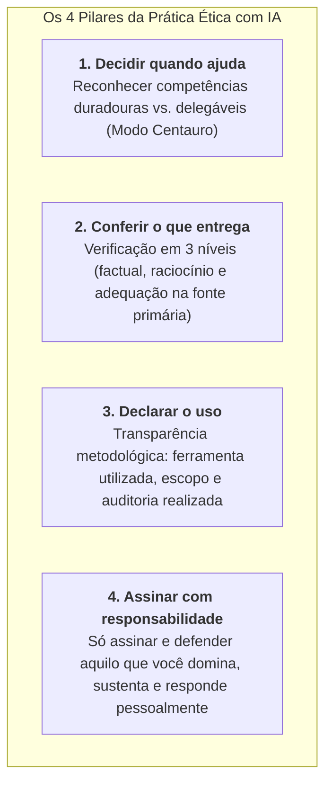

# ✨ Em Síntese — O Fechamento Oficial de COM170

> **Disciplina:** Inteligência Artificial na Prática Acadêmica e Profissional (`COM170`)  
> **Docente Responsável:** Prof. Dr. José Avelino Placca  
> **Coordenação e Mediação Pedagógica:** Equipe Univesp  
> **Quinzena 8** | Bimestre: 2026S2B1 — Univesp  

---

## 🎓 Mensagem Final da Disciplina

> *"Chegamos ao fim da disciplina. Agradecemos o empenho de cada estudante desta turma: quem estudou nos horários que a rotina permitia, quem organizou o trabalho do grupo, quem levou perguntas para as lives e para o fórum, quem enviou sugestões. Agradecemos também aos facilitadores e aos supervisores, que acompanharam vocês de perto, e a todas as pessoas que ajudaram a ajustar a disciplina enquanto ela acontecia.*  
> *Parabéns pela dedicação e sucesso na sua trajetória!*  
>  
> *Você chegou ao fim da jornada de aprendizado na disciplina Inteligência Artificial na Prática!*  
>  
> *Esperamos que vocês levem desta disciplina uma prática para a vida acadêmica e profissional: **usar a IA de forma ética**. Isso significa decidir quando a ferramenta ajuda, conferir o que ela entrega, declarar como vocês a usaram e assinar apenas o que vocês conseguem explicar e defender. As ferramentas vão mudar muitas vezes nos próximos anos, e essas perguntas valem para qualquer uma delas.*  
>  
> *Boa prova!"*

---

## 🏛️ Os Quatro Pilares do Legado da Disciplina

As ferramentas e modelos de inteligência artificial mudarão drasticamente nos próximos anos, mas os quatro pilares metodológicos e éticos desenvolvidos nesta jornada permanecem válidos e universais:

---

## 🏁 Checklist de Conclusão da Disciplina

* [x] **Quinzenas 1 a 7:** Módulos, atividades interativas, portfólios e trabalhos em grupo concluídos com nota máxima.
* [x] **Quinzena 8 — Videoaula de Revisão:** Assistida e sintetizada com conexões para a prova ([`2-Videoaula-Revisao-Geral.md`](./2-Videoaula-Revisao-Geral.md)).
* [x] **Quinzena 8 — E-book de Revisão:** Estudo das 40 páginas e dos 7 casos de prova comentados ([`3-Ebook-de-Revisao-Quinzenas-1-a-7.md`](./3-Ebook-de-Revisao-Quinzenas-1-a-7.md)).
* [x] **Quinzena 8 — Pesquisa "Conte para nós":** Roteiro e reflexões estruturadas ([`4-Questionario-Conte-para-nos.md`](./4-Questionario-Conte-para-nos.md)).
* [ ] **Live de Revisão com Prof. Placca:** 05/11 às 19h (ou gravação no AVA em 06/11).
* [ ] **Prova Presencial Oficial:** Realização no polo de apoio presencial.
