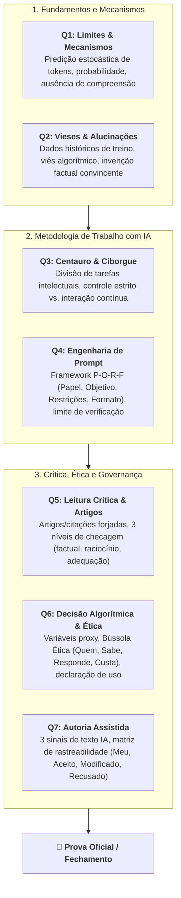

# 🎯 Quinzena 8 — Revisão Geral & Preparação para a Prova Final

> **Disciplina:** Inteligência Artificial na Prática Acadêmica e Profissional (`COM170`)  
> **Docente Responsável:** Prof. Dr. José Avelino Placca  
> **Bimestre:** 2026S2B1 — Univesp  
> **Status:** 🟡 **Em Andamento**  

---

## 🧭 Visão Geral e Mapa da Revisão

A **Quinzena 8** fecha o ciclo formativo de COM170. O objetivo desta quinzena é consolidar todos os conceitos trabalhados nas 7 quinzenas anteriores para a avaliação oficial da Univesp, estruturando o conhecimento teórico, metodológico e ético:

---

## 📁 Estrutura da Quinzena 8

* [x] [**`0-Datas-da-Quinzena-8.md`**](./0-Datas-da-Quinzena-8.md) — Calendário oficial, marcos da live e prazo do questionário final
* [x] [**`1-Introducao.md`**](./1-Introducao.md) — Apresentação oficial do Prof. Dr. José Avelino Placca e os 3 materiais de preparação
* [x] [**`2-Videoaula-Revisao-Geral.md`**](./2-Videoaula-Revisao-Geral.md) — Síntese analítica completa da videoaula oficial: desnaturalizar, reconstruir e as conexões entre quinzenas para a prova
* [x] [**`3-Ebook-de-Revisao-Quinzenas-1-a-7.md`**](./3-Ebook-de-Revisao-Quinzenas-1-a-7.md) — Guia consolidado do E-book oficial de 40 páginas com mapas conceituais e as 7 situações de prova comentadas
* [x] [**`4-Questionario-Conte-para-nos.md`**](./4-Questionario-Conte-para-nos.md) — Roteiro de feedback institucional com sugestões reflexivas para as perguntas abertas
* [x] [**`5-Em-sintese.md`**](./5-Em-sintese.md) — Mensagem final de encerramento da disciplina e os quatro pilares da prática ética com IA
* [ ] [`6-Questionario-Final-Quinzena-8.md`](./6-Questionario-Final-Quinzena-8.md) *(se houver questionário avaliativo com questões no AVA)*
