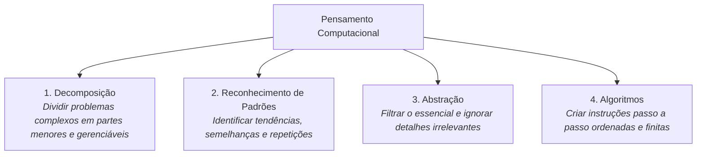

# Semana 1 - Conceitos e Pilares do Pensamento Computacional

> **Disciplina:** Pensamento Computacional (COM100)  
> **Professor Responsável:** Prof. Dr. Ronaldo Celso Messias Correia / Prof. Dr. Marcos Borges  
> **Bimestre:** 2026S2B1 - Univesp

---

Olá, estudante!

Boas-vindas à **Semana 1** da disciplina **Pensamento Computacional (COM100)**!

Nesta primeira semana, você iniciará uma jornada essencial não apenas para as ciências exatas e engenharias, mas para qualquer área do conhecimento humano no século XXI: o desenvolvimento do **Pensamento Computacional**. Longe de se restringir à simples programação de computadores ou ao uso técnico de ferramentas de informática, o pensamento computacional é uma habilidade analítica e cognitiva fundamental para a resolução sistemática de problemas complexos.

Conforme consagrado pela cientista da computação **Jeannette Wing** em seu influente artigo de 2006, o pensamento computacional representa uma atitude e uma competência universal que toda pessoa deve desenvolver. Trata-se de pensar como um cientista da computação quando confrontado com um desafio: entender o problema, modelá-lo, identificar regularidades e construir passos lógicos replicáveis para sua solução.

---

## 🎯 Objetivos de aprendizagem

Ao final desta semana, você deverá ser capaz de:

- Definir o conceito de Pensamento Computacional e sua relevância no contexto acadêmico e profissional contemporâneo;
- Identificar e compreender os **quatro pilares estruturais** do pensamento computacional: **Decomposição**, **Reconhecimento de Padrões**, **Abstração** e **Algoritmos**;
- Distinguir entre o pensamento computacional "desplugado" (sem uso de computadores) e plugado;
- Aplicar os quatro pilares na resolução de problemas cotidianos e organizacionais;
- Reconhecer o papel do pensamento computacional na formação cidadã e no desenvolvimento de raciocínio crítico.

---

## 🧱 Os Quatro Pilares do Pensamento Computacional

1. **Decomposição:** Consiste em quebrar um problema complexo, sistema ou processo em partes menores, facilitando a análise e a solução individual de cada componente.
2. **Reconhecimento de Padrões:** Consiste na busca por similaridades, regularidades e características comuns entre diferentes problemas ou partes de um mesmo problema, permitindo reaproveitar estratégias anteriores.
3. **Abstração:** Consiste no processo de focar exclusivamente nas informações cruciais e indispensáveis para a resolução do problema, deixando de lado detalhes específicos e irrelevantes para o modelo geral.
4. **Algoritmos:** Consiste na elaboração de um conjunto ordenado, claro, finito e não ambíguo de instruções ou regras que devem ser seguidas passo a passo para atingir a solução desejada.

---

## 🧩 Desafio da Semana: O Robô Aspirador e a Computação Desplugada

Considere a automação de um dispositivo autônomo (como um robô aspirador de pó) responsável por mapear e limpar uma residência com múltiplos cômodos e obstáculos móveis:

1. **Decomposição:** Como subdividir o problema macro "limpar a residência de forma eficiente" em subproblemas menores e operacionais?
2. **Reconhecimento de Padrões:** Que tipos de padrões de sujeira, layout de cômodos ou rotinas de horários podem ser identificados para otimizar o trabalho?
3. **Abstração:** Quais detalhes do ambiente são absolutamente necessários para o mapa lógico do robô e quais podem ser completamente ignorados (ex.: cor dos móveis, valor financeiro dos objetos)?
4. **Algoritmo:** Que sequência lógica básica de instruções o robô deve executar ao encontrar uma parede ou um obstáculo imprevisto?

---

## 🎥 Material-base: Videoaulas

### 🎬 Videoaula 1 - Introdução ao Pensamento Computacional
* **Professor:** Prof. Dr. Ronaldo Celso Messias Correia (Univesp)
* **Tema:** O que é pensamento computacional, origens históricas, Jeannette Wing e a transição da computação instrumental para a computação cognitiva.
* **Resumo:** A aula introduz o pensamento computacional como uma competência transversal e emancipatória. Discute como a evolução das tecnologias digitais demanda profissionais capazes de formular problemas de modo que humanos ou máquinas possam executá-los com precisão, destacando exemplos práticos da vida diária e da indústria.

### 🎬 Videoaula 2 - Os Pilares do Pensamento Computacional
* **Professor:** Prof. Dr. Marcos Borges (Univesp)
* **Tema:** Detalhamento formal dos quatro pilares: Decomposição, Reconhecimento de Padrões, Abstração e Algoritmos.
* **Resumo:** Apresentação aprofundada de cada um dos quatro pilares com exemplos práticos: desde a organização de rotinas e receitas culinárias até a criação de modelos matemáticos e automação de processos industriais. Demonstração de testes mentais e aplicações em computação desplugada.

---

## 📚 Leituras Recomendadas

* **Texto-base:** *Computational Thinking* (Jeannette M. Wing, Communications of the ACM, 2006). Ver resumo em [`0.1-Texto-base.md`](file:///home/henrique/Modelos/Univesp/2026S2B1/COM100-Pensamento-Computacional/Semana-1/0.1-Texto-base.md).
* **Material Complementar:** *CS Unplugged: Computação Sem Computador* (Tim Bell et al.). Ver detalhes em [`0.2-Material-de-apoio-Aprofundando-o-tema.md`](file:///home/henrique/Modelos/Univesp/2026S2B1/COM100-Pensamento-Computacional/Semana-1/0.2-Material-de-apoio-Aprofundando-o-tema.md).
