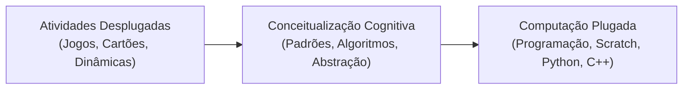

# 0.2 - Material de Apoio e Aprofundando o Tema: Computação Desplugada

> **Tema:** Computação Desplugada (*CS Unplugged*) e o Pensamento Computacional na Prática  
> **Autores Principais:** Tim Bell, Ian H. Witten e Mike Fellows (Universidade de Canterbury)

---

## 🔌 O Que é Computação Desplugada?

O movimento **CS Unplugged** (Computação Desplugada) foi desenvolvido na Nova Zelândia com o propósito de ensinar conceitos fundamentais de Ciência da Computação sem a utilização de computadores, telas ou dispositivos eletrônicos.

A proposta pedagógica utiliza:
- Cartões com números e pontos (para sistema binário);
- Cordas e nós (para grafos e redes);
- Balanças de dois pratos (para algoritmos de ordenação como *QuickSort* e *BubbleSort*);
- Tabuleiros, labirintos e jogos teatrais (para algoritmos de busca e detecção de erros por paridade).

---

## 🎯 Por que Ensinar Computação de Forma Desplugada?

1. **Foco no Raciocínio, Não na Ferramenta:** Quando os estudantes começam a programar direto no computador, frequentemente gastam energia excessiva tentando corrigir erros de digitação, sintaxe ou problemas de interface. A abordagem desplugada isola a lógica pura.
2. **Inclusão e Democracia Digital:** Permite que escolas e estudantes em qualquer condição socioeconômica aprendam os conceitos mais avançados de computação com materiais simples como papel, lápis e barbante.
3. **Engajamento Corporal e Social:** O aprendizado cinestésico e cooperativo estimula a empatia, o trabalho em grupo e a discussão dialógica entre pares.

---

## 📊 Exemplo Prático: A Mágica da Detecção de Erros (Bits de Paridade)

Uma das atividades desplugadas mais famosas ensina como placas de rede e discos rígidos detectam se um dado foi corrompido durante a transmissão:
- Uma matriz $5 \times 5$ de cartas pretas e brancas é disposta sobre a mesa.
- Adiciona-se uma 6ª linha e uma 6ª coluna de cartas extras (bits de paridade), de modo que cada linha e cada coluna tenha sempre um número **par** de cartas pretas.
- Um estudante vira uma carta secretamente enquanto o examinador está de olhos vendados.
- Ao olhar a matriz, o examinador imediatamente identifica qual carta foi virada, pois ela pertence à única linha e à única coluna com número **ímpar** de cartas pretas.

Esse jogo demonstra na prática a matemática dos **Códigos de Hamming** e a **Verificação de Paridade** usada na Internet global.
