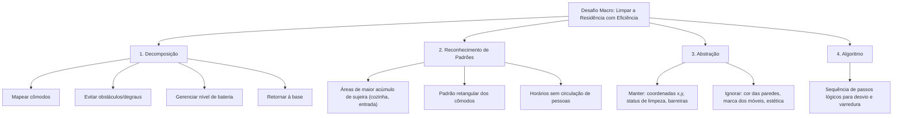

# 2 - Resolução do Desafio: O Robô Aspirador e a Aplicação dos 4 Pilares

> **Atividade:** Desafio da Semana 1 - Pensamento Computacional Desplugado  
> **Tema:** Modelagem dos Quatro Pilares aplicada à navegação de um robô aspirador autônomo.

---

## 🎯 Proposta de Resolução Estruturada

Para demonstrar a aplicação integrada dos quatro pilares do Pensamento Computacional, resolvemos o desafio do projeto do robô aspirador inteligente:



---

## 📝 Respostas Fundamentadas às Questões

### 1. Decomposição
O objetivo macro de "limpar uma casa" é dividido nos seguintes módulos funcionais independentes:
- **Módulo de Navegação:** Ler sensores de proximidade e infravermelho para mover-se em linha reta.
- **Módulo de Detecção de Obstáculos:** Identificar paredes, pés de mesa e degraus (*anti-queda*).
- **Módulo de Limpeza:** Acionar escovas rotativas e motor de sucção com potência adaptativa.
- **Módulo Energético:** Monitorar a porcentagem de carga da bateria e acionar o retorno automático quando o nível atingir 15%.

### 2. Reconhecimento de Padrões
- **Padrão Espacial:** A maioria dos cômodos possui paredes perpendiculares (ângulos de 90°). Um padrão de varredura em "zig-zag" (ou linhas paralelas) é matematicamente mais eficiente do que movimentos aleatórios.
- **Padrão Temporal:** Áreas como a cozinha acumulam mais resíduos após os horários de refeição; a sala de estar acumula poeira próxima às janelas.

### 3. Abstração
- **Dados Relevantes Mantidos no Modelo:** Matriz bidimensional de células (livre, ocupada por obstáculo, limpa, pendente de limpeza), coordenadas $(X, Y)$ da base de carregamento e nível percentual de bateria.
- **Detalhes Irrelevantes Descartados:** Cor da mobília, temperatura ambiente (desde que dentro dos limites operacionais), valor financeiro dos objetos e tipo de decoração.

### 4. Algoritmo Básico de Desvio de Obstáculo
```
Início
    Enquanto (Bateria > 15% E ÁreasPendentes > 0) Faça:
        Avançar_Frente(velocidade_padrao)
        Se Sensor_Obstaculo = VERDADEIRO Então:
            Parar_Motores()
            Recuar(5 cm)
            Girar_Direita(90 graus)
            Se Sensor_Obstaculo = VERDADEIRO Então:
                Girar_Direita(90 graus) // virou 180 graus no total
            FimSe
        FimSe
        Se Sensor_Degrau = VERDADEIRO Então:
            Parar_Imediato()
            Recuar(10 cm)
            Girar_Aleatorio(90 a 180 graus)
        FimSe
    FimEnquanto
    Executar_Rotina_Retornar_A_Base()
Fim
```

---

## 💬 Mensagem Pronta para o Fórum Temático

> **Título do Tópico:** Aplicação Prática dos 4 Pilares no Desafio do Robô Autônomo  
>
> Olá a todas e todos!  
> 
> Ao analisar o desafio desta semana, percebi com muita clareza que o Pensamento Computacional é, antes de tudo, uma ferramenta de organização mental. A modelagem do robô aspirador ilustra perfeitamente como problemas complexos se tornam simples quando aplicamos a decomposição (separando navegação, sucção e recarga) e a abstração (focando apenas nas coordenadas dos obstáculos e ignorando aspectos estéticos do ambiente).  
> 
> O que mais me chamou a atenção foi como o reconhecimento de padrões nos permite projetar um algoritmo em zigue-zague muito superior à movimentação estocástica (aleatória), economizando bateria e garantindo 100% de cobertura da área.  
> 
> Um abraço a todos e bons estudos!
