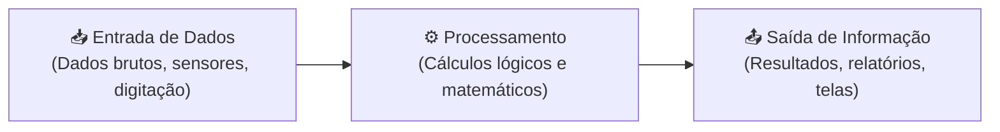

# Semana 2 - Lógica de Programação, Algoritmos e sua Representação

> **Disciplina:** Pensamento Computacional (COM100)  
> **Professor Responsável:** Prof. Dr. Marcos Borges / Prof. Dr. Ronaldo Celso Messias Correia  
> **Bimestre:** 2026S2B1 - Univesp

---

Olá, estudante!

Boas-vindas à **Semana 2** da disciplina **Pensamento Computacional (COM100)**!

Nesta semana, avançaremos dos conceitos teóricos do pensamento computacional para a estruturação prática do raciocínio lógico e a representação formal de **algoritmos**. 

Um algoritmo é uma sequência finita, não ambígua e ordenada de passos para a realização de uma tarefa ou solução de um problema. Todo processo computacional baseia-se no modelo fundamental de **Entrada $\rightarrow$ Processamento $\rightarrow$ Saída** (*Input-Process-Output*).

Aprenderemos as principais formas de representar um algoritmo antes de codificá-lo:
1. **Descrição Narrativa:** Linguagem natural estruturada;
2. **Fluxograma (Diagrama de Blocos):** Representação gráfica com símbolos geométricos padronizados (ANSI/ISO);
3. **Pseudocódigo (Portugol):** Linguagem intermediária estruturada próxima às linguagens de programação reais.

---

## 🎯 Objetivos de aprendizagem

Ao final desta semana, você deverá ser capaz de:

- Definir algoritmo e reconhecer o ciclo de Entrada, Processamento e Saída;
- Compreender e utilizar diferentes formas de representação algorítmica (Descrição Narrativa, Fluxograma e Pseudocódigo);
- Reconhecer os símbolos padronizados de fluxogramas (início/fim, entrada de dados, processamento, tomada de decisão e exibição de saída);
- Realizar **testes de mesa** (*trace table*) para verificação manual de consistência lógica;
- Identificar a eficiência e a clareza lógica em diferentes soluções para um mesmo problema.

---

## 📊 O Ciclo Fundamental de Computação

---

## 🧩 Desafio da Semana: Sistema de Cálculo de Média e Aprovação Escolar

Projetar um algoritmo que leia o nome de um estudante e quatro notas bimestrais (de 0 a 10). O algoritmo deve:
1. Calcular a média aritmética ponderada ou simples;
2. Se a média for maior ou igual a 7.0, informar que o estudante está **"Aprovado"**;
3. Se a média estiver entre 5.0 e 6.9, informar que o estudante está em **"Recuperação"**;
4. Se a média for menor que 5.0, informar **"Reprovado"**;
5. Representar o algoritmo em **Fluxograma ANSI** e em **Pseudocódigo estruturado**, acompanhado do respectivo **Teste de Mesa**.

---

## 🎥 Material-base: Videoaulas

### 🎬 Videoaula 3 - Introdução a Algoritmos e Lógica de Programação
* **Professor:** Prof. Dr. Marcos Borges
* **Tema:** Definição de algoritmos, instruções sequenciais e a tríade Entrada-Processamento-Saída.
* **Resumo:** A aula aborda a transição do pensamento humano para a formulação algorítmica. O professor explica as propriedades fundamentais de um bom algoritmo (finitude, clareza, determinismo e eficácia) e demonstra a modelagem de problemas simples do cotidiano.

### 🎬 Videoaula 4 - Formas de Representação de Algoritmos: Fluxogramas e Pseudocódigo
* **Professor:** Prof. Dr. Marcos Borges
* **Tema:** Símbolos geométricos padrão de fluxogramas, sintaxe de pseudocódigo e operadores relacionais/lógicos.
* **Resumo:** Explicação minuciosa dos blocos de início/fim (elipse/terminador), operações aritméticas (retângulo), leitura e impressão de dados (paralelogramo/display) e estruturas de decisão condicional (losango).

### 🎬 Videoaula 5 - Teste de Mesa e Verificação Lógica
* **Professor:** Prof. Dr. Ronaldo Celso Messias Correia
* **Tema:** Como rastrear variáveis e validar a lógica de um algoritmo passo a passo sem precisar de um computador.
* **Resumo:** Demonstração prática do preenchimento de uma tabela de rastreamento de variáveis com diferentes cenários de entrada para identificar erros de lógica (*bugs*) antes da implementação.

---

## 📚 Leituras Recomendadas

* **Texto-base:** *Lógica de Programação: A Construção de Algoritmos e Estruturas de Dados* (André Luiz Villar Forbellone e Henri Frederico Ebersp沟通cher). Ver resumo em [`0.1-Texto-base.md`](file:///home/henrique/Modelos/Univesp/2026S2B1/COM100-Pensamento-Computacional/Semana-2/0.1-Texto-base.md).
* **Material Complementar:** *Ferramentas Visuais de Aprendizagem de Algoritmos (Flowgorithm e Portugol Studio)*. Ver detalhes em [`0.2-Material-de-apoio-Aprofundando-o-tema.md`](file:///home/henrique/Modelos/Univesp/2026S2B1/COM100-Pensamento-Computacional/Semana-2/0.2-Material-de-apoio-Aprofundando-o-tema.md).
