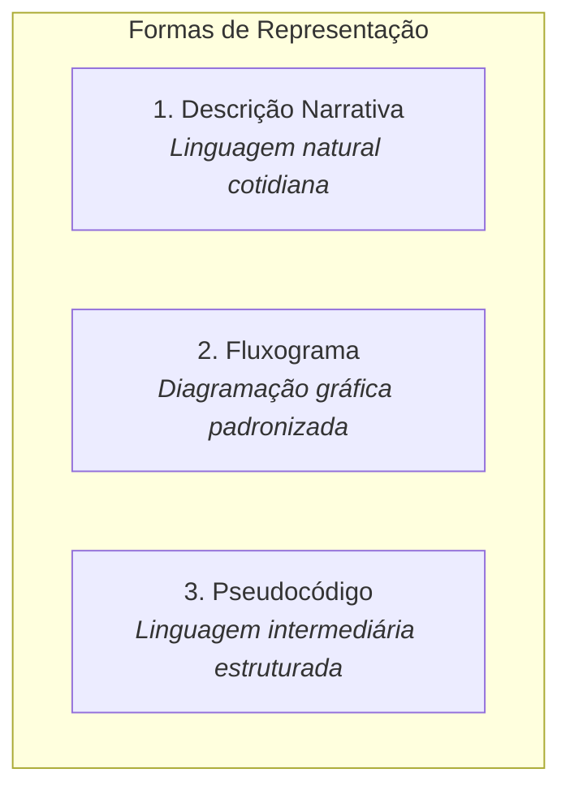

# 0.1 - Texto-base: Fundamentos de Lógica e Construção de Algoritmos

> **Obra de Referência:** *Lógica de Programação: A Construção de Algoritmos e Estruturas de Dados* (3ª Edição)  
> **Autores:** André Luiz Villar Forbellone e Henri Frederico Eberspächer  
> **Editora:** Prentice Hall / Pearson

---

## 📖 Conceitos Fundamentais

Um **algoritmo** é formalmente caracterizado como uma sequência finita de regras, raciocínios ou operações que, aplicada a um conjunto de dados de entrada, produz uma solução após um número finito de etapas.

### Propriedades Obrigatórias de um Algoritmo:
1. **Finitude:** Um algoritmo deve sempre terminar após um número finito de passos; não pode entrar em laços infinitos não intencionais.
2. **Determinismo (Não Ambiguidade):** Cada instrução deve ser precisa e unívoca; dada a mesma entrada e as mesmas condições, a execução sempre produzirá o mesmo resultado.
3. **Entrada (*Input*):** Pode receber zero ou mais dados externos.
4. **Saída (*Output*):** Deve produzir ao menos um resultado útil.
5. **Efetividade:** Todas as operações devem ser básicas o suficiente para que possam ser executadas em tempo finito.

---

## 📐 Comparativo das Formas de Representação

| Forma | Vantagens | Desvantagens |
| :--- | :--- | :--- |
| **Descrição Narrativa** | Fácil compreensão para leigos; não exige conhecimento de símbolos. | Alta ambiguidade; imprecisão semântica; difícil conversão direta para código. |
| **Fluxograma** | Excelente visualização do fluxo de controle e bifurcações condicionais; padrão universal. | Trabalhoso para algoritmos longos e complexos; consome muito espaço visual. |
| **Pseudocódigo** | Rigor lógico elevado; quase idêntico às linguagens de programação reais; compacto. | Exige aprendizado de regras sintáticas e convenções estruturais. |

---

## 🔷 Símbolos Padrão em Fluxogramas (ISO/ANSI)

- **Elipse / Retângulo Arredondado (Terminador):** Indica o **Início** ou o **Fim** do algoritmo.
- **Paralelogramo:** Operação de **Entrada Manual** de dados (leitura pelo teclado).
- **Retângulo:** Ação de **Processamento** ou atribuição de cálculo ($x \leftarrow a + b$).
- **Losango:** Tomada de **Decisão Condicional** (bifurcação lógica com saídas *Sim/Não* ou *V/F*).
- **Display / Documento com base ondulada:** Exibição de **Saída de Dados** na tela ou impressora.
- **Setas de Fluxo:** Indicam a direção e ordem de execução das instruções.

---

## 📋 O Teste de Mesa (*Trace Table*)

O teste de mesa é uma metodologia manual para simular a execução do algoritmo passo a passo:
1. Cria-se uma tabela com uma coluna para o número da linha de instrução, uma coluna para cada variável e uma coluna para a saída na tela.
2. Atribuem-se valores de teste e percorrem-se as instruções, atualizando o valor das variáveis na memória.
3. Verifica-se se a saída gerada corresponde exatamente ao resultado esperado matematicamente.
