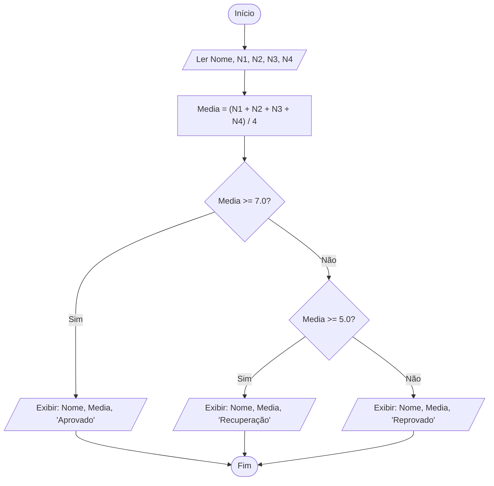

# 2 - Resolução do Desafio: Sistema de Média e Aprovação Escolar

> **Atividade:** Desafio da Semana 2 - Lógica de Programação e Representação  
> **Tema:** Construção de Algoritmo, Fluxograma ANSI, Pseudocódigo Estruturado e Teste de Mesa.

---

## 🎯 Enunciado do Desafio

Desenvolver uma solução algorítmica para uma instituição de ensino que processa o desempenho acadêmico de seus estudantes:
- **Entradas:** Nome do aluno ($Aluno$), Nota 1 ($N1$), Nota 2 ($N2$), Nota 3 ($N3$), Nota 4 ($N4$).
- **Processamento:** Média Aritmética Simples: $Media = \frac{N1 + N2 + N3 + N4}{4}$.
- **Regras de Negócio:**
  - Se $Media \ge 7.0 \rightarrow$ Situação: **"Aprovado"**
  - Se $5.0 \le Media < 7.0 \rightarrow$ Situação: **"Recuperação"**
  - Se $Media < 5.0 \rightarrow$ Situação: **"Reprovado"**
- **Saídas:** Nome do estudante, média calculada e mensagem da situação final.

---

## 🔷 1. Fluxograma Padrão ANSI (Diagrama Mermaid)



---

## 💻 2. Pseudocódigo Estruturado (Portugol)

```pascal
Algoritmo "Calculo_Media_Escolar"
Var
    nomeAluno : Caractere
    nota1, nota2, nota3, nota4 : Real
    mediaFinal : Real
    situacao : Caractere

Inicio
    // Entrada de Dados
    Escreva("Digite o nome do estudante: ")
    Leia(nomeAluno)
    Escreva("Digite as 4 notas bimestrais (0 a 10): ")
    Leia(nota1, nota2, nota3, nota4)

    // Processamento
    mediaFinal <- (nota1 + nota2 + nota3 + nota4) / 4.0

    // Estrutura Condicional Encadeada
    Se (mediaFinal >= 7.0) Entao
        situacao <- "Aprovado"
    Senao
        Se (mediaFinal >= 5.0) Entao
            situacao <- "Em Recuperação"
        Senao
            situacao <- "Reprovado"
        FimSe
    FimSe

    // Saída de Dados
    Escreval("-----------------------------------------")
    Escreval("Estudante: ", nomeAluno)
    Escreval("Média Final: ", mediaFinal:4:2)
    Escreval("Resultado: ", situacao)
    Escreval("-----------------------------------------")
Fim
```

---

## 📊 3. Teste de Mesa (*Trace Table*)

| Cenário | Entrada (`nomeAluno`) | $N1, N2, N3, N4$ | Processamento (`mediaFinal`) | Condição 1 ($\ge 7.0$) | Condição 2 ($\ge 5.0$) | Saída Gerada (`situacao`) |
| :---: | :--- | :---: | :---: | :---: | :---: | :--- |
| **1** | "Carlos Silva" | $8.0, 7.5, 9.0, 7.5$ | $\frac{32.0}{4} = 8.00$ | **Verdadeiro** | - (não avaliada) | Carlos Silva - Média 8.00 - **Aprovado** |
| **2** | "Mariana Souza" | $6.0, 5.5, 7.0, 5.5$ | $\frac{24.0}{4} = 6.00$ | Falso | **Verdadeiro** | Mariana Souza - Média 6.00 - **Em Recuperação** |
| **3** | "Pedro Santos" | $4.0, 3.5, 5.0, 3.5$ | $\frac{16.0}{4} = 4.00$ | Falso | Falso | Pedro Santos - Média 4.00 - **Reprovado** |

---

## 💬 Mensagem Pronta para o Fórum Temático

> **Título do Tópico:** Modelagem Algorítmica e Teste de Mesa do Sistema de Notas  
>
> Olá a todos!  
> 
> Gostaria de compartilhar a resolução do desafio da Semana 2. A construção do fluxograma com o modelo de decisão encadeada permitiu visualizar com clareza as três saídas possíveis sem redundância de testes.  
> 
> O teste de mesa foi crucial para verificar os casos limítrofes (exatamente 7.0 e exatamente 5.0), garantindo que as notas de corte fossem tratadas com precisão pelo operador $\ge$. A formalização em pseudocódigo também facilita muito a transposição futura para linguagens reais como Python, C++ ou blocos do Scratch.  
> 
> Bons estudos a todos!
