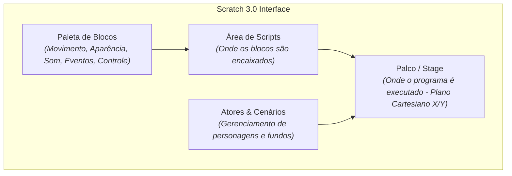

# Semana 3 - Scratch: Ambiente para Ensino e Aprendizagem (Parte I)

> **Disciplina:** Pensamento Computacional (COM100)  
> **Parceria:** Rede Brasileira de Aprendizagem Criativa (RBAC)  
> **Bimestre:** 2026S2B1 - Univesp

---

Olá, estudante!

Boas-vindas à **Semana 3** da disciplina **Pensamento Computacional (COM100)**!

Nesta semana, você terá o primeiro contato imersivo com o **Scratch**, uma plataforma visual de programação desenvolvida pelo grupo *Lifelong Kindergarten* do MIT Media Lab, liderado pelo Prof. **Mitchel Resnick**.

Diferente das linguagens textuais tradicionais em que pequenos erros de digitação (como um ponto e vírgula esquecido) geram erros de sintaxe frustrantes, o Scratch utiliza blocos de encaixe visual coloridos baseados em metáforas de peças de Lego. Isso elimina a barreira da sintaxe e permite ao estudante focar integralmente na **lógica**, na **criatividade** e na **narrativa**.

---

## 🎯 Objetivos de aprendizagem

Ao final desta semana, você deverá ser capaz de:

- Conhecer e navegar pela interface do Scratch (Área de Blocos, Área de Scripts, Palco e Lista de Atores/Cenários);
- Compreender o conceito de **Atores** (*Sprites*), **Fantasias** (*Costumes*), **Sons** e **Cenários** (*Backdrops*);
- Utilizar blocos da categoria **Eventos** (como "quando a bandeira verde for clicada") para iniciar ações;
- Programar deslocamentos, giros e coordenadas cartesianas $(X, Y)$ através da categoria **Movimento**;
- Utilizar blocos de controle de repetição simples e infinita (**Repita [N] vezes** e **Sempre**);
- Desenvolver animações sequenciais interativas com alternância de fantasias e reprodução sonora.

---

## 🧱 A Anatomia da Interface do Scratch

---

## 🧩 Desafio da Semana: Criando uma Dança Interativa no Scratch

Criar um projeto no Scratch em que um personagem (ator) execute uma coreografia animada ao som de uma música:
1. Escolha ou desenhe um Ator que possua ao menos 2 ou mais **fantasias** distintas de movimento.
2. Defina um **cenário** temático adequado (ex.: palco de teatro, pista de dança ou rua).
3. Ao clicar na **Bandeira Verde**, o ator deve ir para o centro $(X=0, Y=0)$, tocar uma batida rítmica contínua e alternar entre suas fantasias utilizando um laço de repetição com pausa (`espere 0.2 segundos`).
4. Ao pressionar a **barra de espaço**, o ator deve dar um pulo (deslocar no eixo Y e retornar) e emitir uma saudação usando o bloco `diga "Olá!" por 2 segundos`.

---

## 🎥 Material-base: Videoaulas

### 🎬 Videoaula 6 - Primeiros Passos com o Scratch
* **Apresentação:** Equipe Univesp e RBAC
* **Tema:** Navegação na plataforma online, criação de conta, estrutura do palco e manipulação de coordenadas $X$ e $Y$.
* **Resumo:** Demonstração prática do ambiente do Scratch. Explicação sobre a orientação espacial do palco (de $-240$ a $+240$ em $X$; de $-180$ a $+180$ em $Y$), escolha de sprites na biblioteca e primeiro script com o clássico Gato do Scratch.

### 🎬 Videoaula 7 - Movimento, Aparência e Animação
* **Apresentação:** Equipe Univesp e RBAC
* **Tema:** Como criar a ilusão de movimento através da troca periódica de fantasias e controle de tempo.
* **Resumo:** A aula ensina a sincronizar laços de repetição `sempre` e `repita N vezes` com blocos de `próxima fantasia` e `espere`, criando animações fluidas de caminhada, salto e dança.

### 🎬 Videoaula 8 - Eventos e Interatividade com o Usuário
* **Apresentação:** Equipe Univesp e RBAC
* **Tema:** Gatilhos de eventos: clique na bandeira verde, clique no ator, teclas pressionadas e interações com o mouse.
* **Resumo:** Apresentação de como tornar projetos interativos respondendo aos comandos do usuário pelo teclado e mouse.

---

## 📚 Leituras Recomendadas

* **Texto-base:** *Jardim de Infância para a Vida Toda* (Mitchel Resnick - Cap. 1: Criatividade e Espiral da Aprendizagem Criativa). Ver resumo em [`0.1-Texto-base.md`](file:///home/henrique/Modelos/Univesp/2026S2B1/COM100-Pensamento-Computacional/Semana-3/0.1-Texto-base.md).
* **Material Complementar:** *Guia de Computação Criativa - Unidade 1: Explorando* (Harvard Graduate School of Education). Ver detalhes em [`0.2-Material-de-apoio-Aprofundando-o-tema.md`](file:///home/henrique/Modelos/Univesp/2026S2B1/COM100-Pensamento-Computacional/Semana-3/0.2-Material-de-apoio-Aprofundando-o-tema.md).
