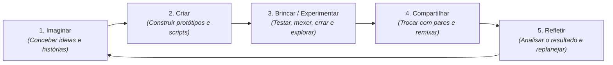

# 0.1 - Texto-base: A Filosofia do Scratch e a Aprendizagem Criativa

> **Obra de Referência:** *Jardim de Infância para a Vida Toda: Por uma Aprendizagem Criativa, Mão na Massa e Relevante para Todos*  
> **Autor:** Mitchel Resnick (Diretor do *Lifelong Kindergarten Group* - MIT Media Lab)  
> **Prefácio:** Sir Ken Robinson

---

## 📖 A Espiral da Aprendizagem Criativa

Mitchel Resnick fundamenta o desenvolvimento do Scratch na teoria do **Construcionismo**, criada por seu mentor **Seymour Papert** (criador da linguagem LOGO e da tartaruga robótica). Segundo Resnick, a melhor forma de aprender é construir ativamente coisas que tenham significado pessoal e social.

O processo de aprendizagem criativa não é linear, mas opera em uma espiral contínua de cinco fases:

---

## 🌟 Os Quatro Ps da Aprendizagem Criativa

Resnick propõe uma estrutura pedagógica orientada por quatro pilares essenciais:

1. **Projetos (*Projects*):** As pessoas aprendem melhor quando estão trabalhando ativamente no desenvolvimento de um projeto significativo (uma animação, um jogo, uma simulação científica) e não memorizando comandos isolados.
2. **Paixão (*Passion*):** Quando os estudantes trabalham em temas que despertam seu interesse e entusiasmo genuíno, eles dedicam mais tempo, persistem diante de erros difíceis e aprendem com profundidade.
3. **Pares (*Peers*):** A aprendizagem é um processo inerentemente social. No Scratch, a comunidade online global permite visualizar projetos de outros usuários, trocar comentários construtivos e colaborar em equipes.
4. **Pensar Brincando (*Play*):** Brincar não significa apenas diversão descompromissada, mas uma postura exploratória, de assumir riscos intelectuais, testar novas combinações de blocos e encarar os erros como oportunidades de depuração (*debugging*).

---

## 🧩 O Conceito de Remix no Scratch

Uma das maiores inovações pedagógicas da plataforma Scratch é o botão **Remix**:
- Qualquer projeto compartilhado na comunidade tem seu código-fonte aberto e acessível por padrão.
- Qualquer usuário pode abrir o projeto, entender como o autor original construiu a lógica, modificá-lo, adicionar novos personagens e compartilhar a sua versão derivada.
- A plataforma mantém automaticamente a árvore genealógica de autoria, reconhecendo publicamente a contribuição do criador original.
