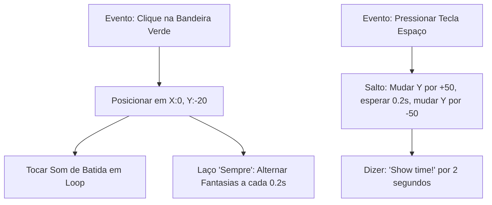

# 2 - Resolução do Desafio: Animação e Dança Interativa no Scratch

> **Atividade:** Desafio da Semana 3 - Scratch e Expressão Criativa  
> **Tema:** Desenvolvimento de Dança Rítmica com Troca de Fantasias, Efeitos Sonoros e Eventos de Teclado.

---

## 🎯 Descrição do Projeto Autoral

O projeto **"Apresentação de Dança do Robô Scratch"** foi concebido para aplicar conceitos de animação em ciclos, sincronismo temporal, coordenadas e respostas a eventos do usuário.



---

## 💻 Estrutura dos Scripts no Scratch

### Script 1: Animação Principal e Música de Fundo (No Ator "Dançarino")
```
quando a bandeira verde for clicada
vá para x: 0 y: -20
aponte para a direção 90
mude o efeito [cor] para 0
sempre
    próxima fantasia
    espere 0.2 segundos
```

### Script 2: Controle de Áudio Contínuo
```
quando a bandeira verde for clicada
sempre
    toque o som [Dance Around] até o fim
```

### Script 3: Interatividade com o Teclado (Tecla Espaço)
```
quando a tecla [espaço] for pressionada
repita 5 vezes
    adicione 10 a y
    espere 0.05 segundos
repita 5 vezes
    adicione -10 a y
    espere 0.05 segundos
diga [Uhuul! Que ritmo incrível!] por 2 segundos
```

---

## 💬 Mensagem Pronta para o Fórum Temático

> **Título do Tópico:** Projeto de Dança Interativa no Scratch - Semana 3  
>
> Olá a todas e todos!  
> 
> Para o desafio desta semana, desenvolvi um projeto focado na sincronização de fantasias e resposta a eventos. Ao utilizar o laço `sempre` com `próxima fantasia` e uma pausa de $0.2$ segundos, criei uma animação contínua muito fluida.  
> 
> A maior descoberta foi separar os scripts em blocos paralelos disparados pela mesma bandeira verde: um script cuida exclusivamente da animação visual enquanto outro cuida da execução contínua da trilha sonora. A tecla espaço adiciona um pulo interativo manipulando as coordenadas do eixo Y.  
> 
> Bons estudos a todos!
