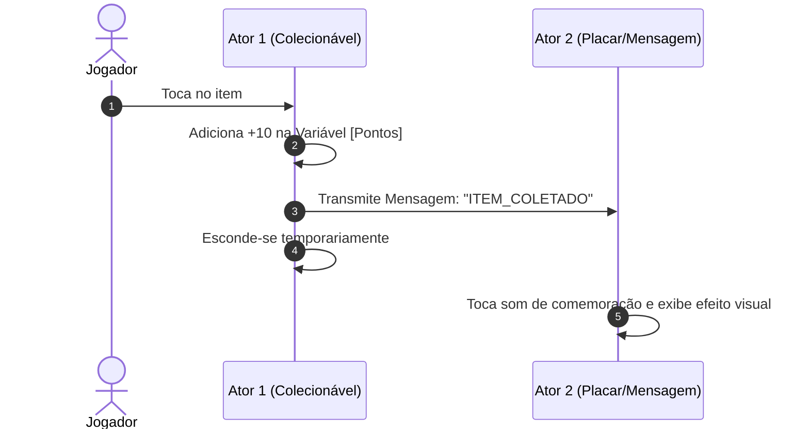

# Semana 4 - Estruturas Condicionais, Variáveis e Interatividade no Scratch e App Inventor

> **Disciplina:** Pensamento Computacional (COM100)  
> **Parceria:** Rede Brasileira de Aprendizagem Criativa (RBAC)  
> **Bimestre:** 2026S2B1 - Univesp

---

Olá, estudante!

Boas-vindas à **Semana 4** da disciplina **Pensamento Computacional (COM100)**!

Nesta semana, avançaremos no domínio do Scratch e em ferramentas de programação visual para dispositivos móveis (como o **MIT App Inventor**). Enquanto na semana anterior aprendemos sobre movimentos e sequências lineares, agora introduziremos o cérebro da lógica computacional: as **estruturas condicionais** (*se / se-senão*), os **sensores de colisão e toque**, a criação e manipulação de **variáveis** de memória (pontuação, vidas, tempo) e a **transmissão de mensagens** (*broadcast*) entre diferentes atores.

Com esses conceitos, você será capaz de transformar animações simples em jogos interativos e aplicativos completos!

---

## 🎯 Objetivos de aprendizagem

Ao final desta semana, você deverá ser capaz de:

- Utilizar blocos de controle condicional simples (`se <condição> então`) e compostos (`se <condição> então ... senão`);
- Aplicar **operadores relacionais** ($>$, $<$, $=$) e **operadores lógicos** (`e`, `ou`, `não`);
- Criar e manipular **variáveis** numéricas e textuais (armazenamento, incremento e reinicialização de pontuação);
- Integrar blocos da categoria **Sensores** (tocando em cor, tocando no ponteiro do mouse, distância até o ator);
- Utilizar o mecanismo de **Transmissão de Mensagens** (`transmita [mensagem]` e `quando eu ouvir [mensagem]`) para sincronizar a comunicação entre múltiplos atores e o palco.

---

## ⚙️ A Lógica de Comunicação por Mensagens (*Broadcast*)

---

## 🧩 Desafio da Semana: O Jogo do "Pega-Estrelas" com Pontuação e Tempo

Construir um jogo no Scratch com os seguintes elementos:
1. Um **Ator Principal** (ex.: um mergulhador ou nave) controlado pelas setas do teclado ou pelo mouse;
2. Um **Ator Colecionável** (ex.: uma estrela mágica) que surge em posições aleatórias na tela a cada 2 segundos;
3. Uma variável **`Pontos`** que inicia em zero e aumenta em 1 ponto a cada vez que o ator principal tocar na estrela (usando o bloco sensor `tocando em [Ator Principal]?`);
4. Uma variável **`Tempo`** (cronômetro regressivo de 30 segundos);
5. Quando o `Tempo` chegar a 0, o jogo deve transmitir a mensagem `"FIM_DE_JOGO"`, exibindo a tela final com a pontuação total do jogador.

---

## 🎥 Material-base: Videoaulas

### 🎬 Videoaula 9 - Estruturas Condicionais e Sensores
* **Apresentação:** Equipe Univesp e RBAC
* **Tema:** Como tomar decisões dinâmicas nos scripts utilizando operadores booleanos e blocos sensores.
* **Resumo:** A aula demonstra a detecção de colisões no palco, uso de bordas, verificação de cores e criação de regras de vitória/derrota.

### 🎬 Videoaula 10 - Manipulação de Variáveis e Pontuação
* **Apresentação:** Equipe Univesp e RBAC
* **Tema:** Definição de variáveis globais e locais, inicialização de contadores e acumuladores.
* **Resumo:** Explicação minuciosa de como criar placares de jogos, cronômetros regressivos e variáveis de status de personagem.

### 🎬 Videoaula 11 - Transmissão de Mensagens e Introdução ao App Inventor
* **Apresentação:** Equipe Univesp
* **Tema:** Desacoplamento de código via *broadcast* no Scratch e introdução à programação em blocos para celulares com o MIT App Inventor.
* **Resumo:** O professor demonstra como coordenar a troca de cenários e o fim de fases transmitindo mensagens, e apresenta a interface de design e blocos do App Inventor.

---

## 📚 Leituras Recomendadas

* **Texto-base:** *Programação Visual e Desenvolvimento de Aplicativos Educacionais* (Hal Abelson e Equipe MIT). Ver resumo em [`0.1-Texto-base.md`](file:///home/henrique/Modelos/Univesp/2026S2B1/COM100-Pensamento-Computacional/Semana-4/0.1-Texto-base.md).
* **Material Complementar:** *Guia Prático de Lógica de Jogos no Scratch*. Ver detalhes em [`0.2-Material-de-apoio-Aprofundando-o-tema.md`](file:///home/henrique/Modelos/Univesp/2026S2B1/COM100-Pensamento-Computacional/Semana-4/0.2-Material-de-apoio-Aprofundando-o-tema.md).
