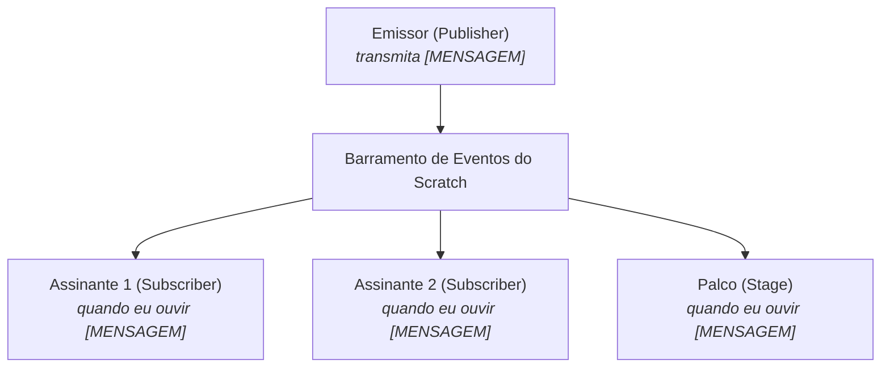

# 0.2 - Material de Apoio: Padrões de Design em Jogos e Aplicações no Scratch

> **Tema:** Arquitetura de Comunicação por Mensagens (*Broadcast*) e Mecânicas de Jogos  
> **Referência:** *Scratch Design Studio* & MIT Lifelong Kindergarten

---

## 📡 O Padrão de Projeto Publish/Subscribe no Scratch

O bloco `transmita [mensagem]` do Scratch implementa o clássico padrão de arquitetura de software conhecido como **Publish/Subscribe (Observer)**:



### Vantagens do Broadcast:
- **Desacoplamento:** O emissor não precisa saber quantos nem quais atores irão reagir à mensagem;
- **Modularidade:** É possível adicionar novos atores e comportamentos sem reescrever o código do personagem principal;
- **Sincronismo de Telas:** Ideal para coordenar troca de fases (*Game Over*, *Vitória*, *Menu Inicial*).

---

## 🕹️ Mecânica de Cronômetro Regressivo com Variável

Para implementar um relógio regressivo preciso:
```
quando a bandeira verde for clicada
mude [Tempo] para 30
repita até que <(Tempo) = 0>
    espere 1 segundos
    adicione -1 a [Tempo]
transmita [FIM_DE_JOGO]
```
Esse bloco garante que a cada 1 segundo real o valor seja decrementado até o disparo do evento final.
