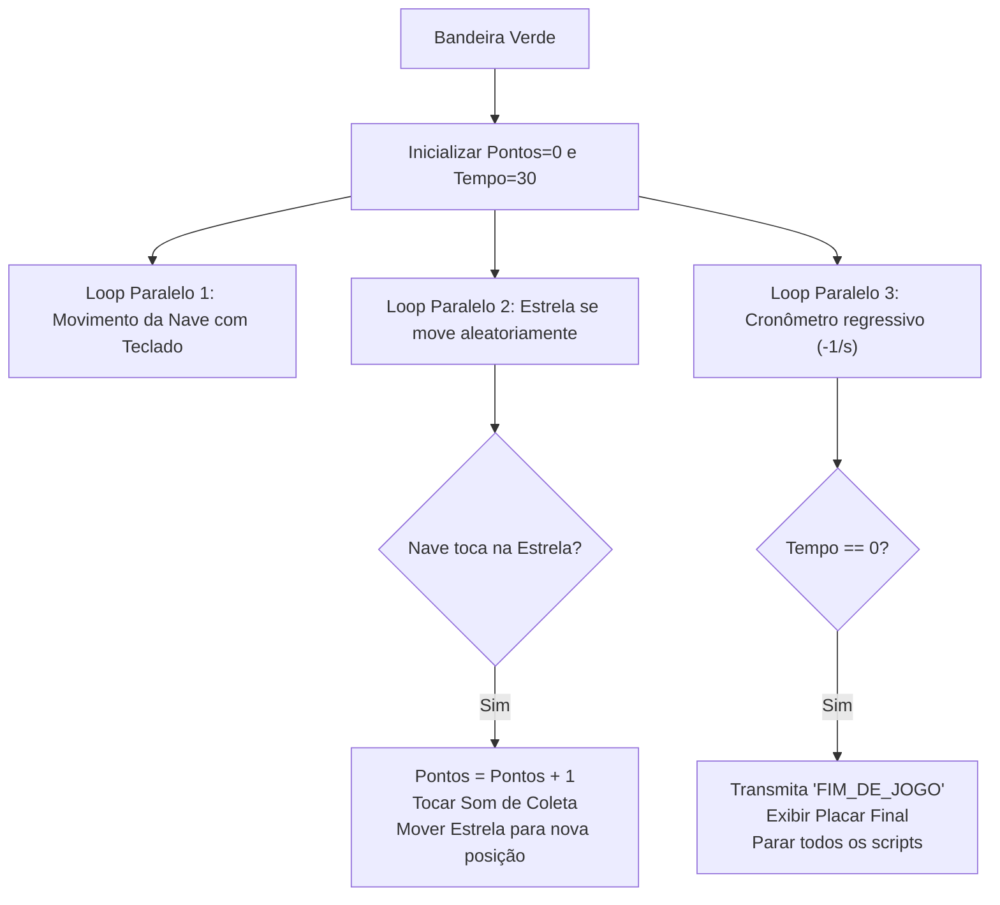

# 2 - Resolução do Desafio: Jogo "Pega-Estrelas" com Placar e Cronômetro

> **Atividade:** Desafio da Semana 4 - Lógica Condicional, Sensores e Variáveis  
> **Tema:** Desenvolvimento de Jogo Completo no Scratch com Controle de Colisão, Pontuação e Cronômetro.

---

## 🎯 Visão Geral do Jogo

O jogo é estruturado com dois atores e o palco:
1. **Ator 1: Nave Espacial (Controlada pelo Jogador)**
2. **Ator 2: Estrela Dourada (Objeto Colecionável Móvel)**
3. **Variáveis Globais:** `Pontos` (inicia em 0) e `Tempo` (inicia em 30).



---

## 💻 Blocos de Código do Projeto

### 🚀 Scripts do Ator 1 ("Nave Espacial")
```
quando a bandeira verde for clicada
vá para x: 0 y: -100
sempre
    se <tecla [seta para a direita] pressionada?> então
        aponte para a direção 90
        adicione 10 a x
    se <tecla [seta para a esquerda] pressionada?> então
        aponte para a direção -90
        adicione -10 a x
    se <tecla [seta para cima] pressionada?> então
        adicione 10 a y
    se <tecla [seta para baixo] pressionada?> então
        adicione -10 a y
```

### ⭐ Scripts do Ator 2 ("Estrela Dourada")
```
quando a bandeira verde for clicada
mostre
sempre
    se <tocando em [Nave Espacial]?> então
        adicione 1 a [Pontos]
        toque o som [Collect]
        vá para x: (número aleatório entre -200 e 200) y: (número aleatório entre -140 e 140)
        espere 0.1 segundos

quando eu ouvir [FIM_DE_JOGO]
esconda
```

### ⏱️ Scripts do Palco ("Controle de Jogo e Cronômetro")
```
quando a bandeira verde for clicada
mude [Pontos] para 0
mude [Tempo] para 30
mude o cenário para [Espaco_Sideral]
repita até que <(Tempo) = 0>
    espere 1 segundos
    adicione -1 a [Tempo]
transmita [FIM_DE_JOGO]
mude o cenário para [Tela_Game_Over]
toque o som [Victory] até o fim
pare [todos]
```

---

## 💬 Mensagem Pronta para o Fórum Temático

> **Título do Tópico:** Desenvolvimento do Jogo "Pega-Estrelas" com Cronômetro e Variáveis  
>
> Olá a todas e todos!  
> 
> Gostaria de compartilhar as soluções desenvolvidas no desafio da Semana 4. A integração entre variáveis de controle (`Tempo` e `Pontos`) e sensores de colisão permitiu transformar scripts simples em uma dinâmica de jogo completa.  
> 
> A maior facilidade técnica foi utilizar o bloco `transmita [FIM_DE_JOGO]` no palco ao término do cronômetro, permitindo que a estrela se esconda automaticamente e o cenário mude para a tela de encerramento sem a necessidade de acoplamento direto entre os códigos dos atores.  
> 
> Um abraço e bons estudos!
