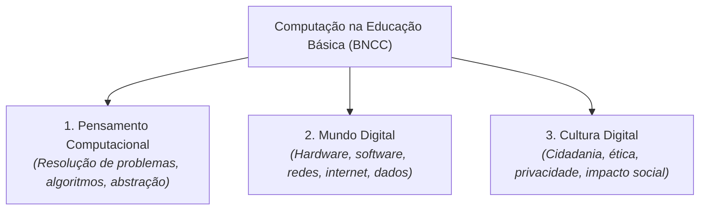

# Semana 5 - Letramento Digital, BNCC e Computação no Século XXI

> **Disciplina:** Pensamento Computacional (COM100)  
> **Professor Responsável:** Prof. Dr. Ronaldo Celso Messias Correia / Prof. Dr. Marcos Borges  
> **Bimestre:** 2026S2B1 - Univesp

---

Olá, estudante!

Boas-vindas à **Semana 5** da disciplina **Pensamento Computacional (COM100)**!

Nesta semana, conectamos o pensamento computacional aos grandes debates sobre **Letramento Digital**, **Cultura Digital** e às diretrizes curriculares nacionais da Educação Básica no Brasil, expressas na **Base Nacional Comum Curricular (BNCC)** e no Parecer CNE/CP nº 2/2022 (Normas sobre Computação na Educação Básica).

O letramento digital vai muito além da capacidade técnica de operar um celular ou navegar em redes sociais. Ele envolve a compreensão crítica das tecnologias, a capacidade de avaliar fontes de informação, a produção autoral e ética de conteúdos digitais, a segurança de dados e a formação cidadã para a sociedade informacional.

---

## 🎯 Objetivos de aprendizagem

Ao final desta semana, você deverá ser capaz de:

- Definir o conceito de **Letramento Digital** e diferenciá-lo da simples alfabetização instrumental;
- Analisar os três eixos estruturantes da Computação na Educação Básica segundo a BNCC: **Pensamento Computacional**, **Mundo Digital** e **Cultura Digital**;
- Reconhecer a importância da ética, segurança da informação, privacidade de dados e cidadania digital;
- Analisar o impacto social da exclusão digital e propor estratégias de inclusão sociodigital;
- Identificar práticas pedagógicas inovadoras que integram recursos digitais e aprendizagem ativa.

---

## 🏛️ Os Três Eixos da Computação na BNCC

---

## 🧩 Desafio da Semana: Plano de Ação para Inclusão e Letramento Digital

Considere uma comunidade escolar em que os alunos utilizam intensamente smartphones para jogos e redes sociais, porém apresentam grande vulnerabilidade a *fake news*, desconhecem práticas básicas de proteção de senhas/privacidade e não utilizam a tecnologia para produção autoral de conhecimento.

Proponha um **Plano de Ação Formativa em Letramento Digital** contendo:
1. **Diagnóstico:** Identificação dos principais desafios de letramento crítico na comunidade;
2. **Oficina Prática de Segurança e Privacidade:** Roteiro com orientações sobre pegada digital (*digital footprint*) e verificação de notícias;
3. **Projeto de Autoria Criativa:** Uma atividade de programação desplugada ou no Scratch onde os alunos produzam campanhas informativas digitais.

---

## 🎥 Material-base: Videoaulas

### 🎬 Videoaula 12 - O Século XXI e a Computação na BNCC (Parte I)
* **Professor:** Prof. Dr. Marcos Borges
* **Tema:** A evolução curricular e a inclusão obrigatória do pensamento computacional e da cultura digital nas escolas brasileiras.
* **Resumo:** A aula contextualiza as demandas educacionais do século XXI e explica como a BNCC estruturou o ensino de computação desde a Educação Infantil até o Ensino Médio.

### 🎬 Videoaula 13 - O Século XXI e a Computação na BNCC (Parte II)
* **Professor:** Prof. Dr. Marcos Borges
* **Tema:** Detalhamento dos eixos Mundo Digital e Cultura Digital, direitos autorais, ética na rede e REAs.
* **Resumo:** Discussão sobre privacidade de dados, segurança digital na escola, combate à desinformação e uso de Recursos Educacionais Abertos (REA).

### 🎬 Videoaula 14 - Letramento Digital e Cidadania Contemporânea
* **Professor:** Prof. Dr. Ronaldo Celso Messias Correia
* **Tema:** Conceito de letramento digital crítico, exclusão digital e o papel emancipatório da tecnologia.
* **Resumo:** Análise das desigualdades de acesso à tecnologia no Brasil e estratégias para formar cidadãos produtores (e não meros consumidores passivos) de tecnologia.

---

## 📚 Leituras Recomendadas

* **Texto-base:** *Diretrizes Curriculares Nacionais para a Educação Básica: Normas sobre Computação* (MEC/CNE). Ver resumo em [`0.1-Texto-base.md`](file:///home/henrique/Modelos/Univesp/2026S2B1/COM100-Pensamento-Computacional/Semana-5/0.1-Texto-base.md).
* **Material Complementar:** *Cultura Digital e Letramento Crítico na Era da Informação*. Ver detalhes em [`0.2-Material-de-apoio-Aprofundando-o-tema.md`](file:///home/henrique/Modelos/Univesp/2026S2B1/COM100-Pensamento-Computacional/Semana-5/0.2-Material-de-apoio-Aprofundando-o-tema.md).
