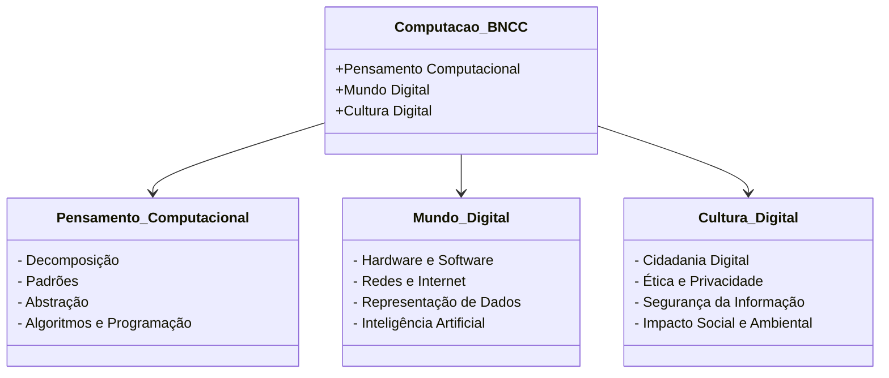

# 0.1 - Texto-base: A Computação na BNCC e os Três Eixos Curriculares

> **Documento de Referência:** *Normas sobre Computação na Educação Básica - Complemento à BNCC*  
> **Órgão:** Conselho Nacional de Educação (CNE) / Ministério da Educação (MEC)  
> **Parecer/Resolução:** CNE/CP nº 2/2022

---

## 📖 Contexto e Justificativa

Em 2022, o Conselho Nacional de Educação aprovou as normas que definem as competências e habilidades em Computação a serem desenvolvidas em todas as etapas da Educação Básica (Educação Infantil, Ensino Fundamental e Ensino Médio) no Brasil.

A premissa pedagógica estabelece que:
> *"O domínio dos conceitos fundamentais da computação é indispensável para que crianças e jovens compreendam e atuem criticamente no mundo contemporâneo, transformando-se de meros usuários consumidores de tecnologia em criadores conscientes e éticos de soluções digitais."*

---

## 🏛️ Os Três Eixos Estruturantes

### 1. Pensamento Computacional
Refere-se à capacidade de compreender, definir, modelar, comparar, solucionar, automatizar e analisar problemas de forma metódica e sistemática, por meio do desenvolvimento de algoritmos.

### 2. Mundo Digital
Envolve a compreensão dos artefatos computacionais (físicos e virtuais), o funcionamento dos computadores, os conceitos de armazenamento, a infraestrutura da Internet, o processamento de dados e as tecnologias emergentes (robótica, inteligência artificial e internet das coisas).

### 3. Cultura Digital
Aborda a compreensão dos impactos da tecnologia na sociedade, a reflexão ética sobre privacidade, pegada de carbono, segurança de dados (LGPD), combate ao ciberbullying e o exercício consciente da cidadania em ambientes digitais.
