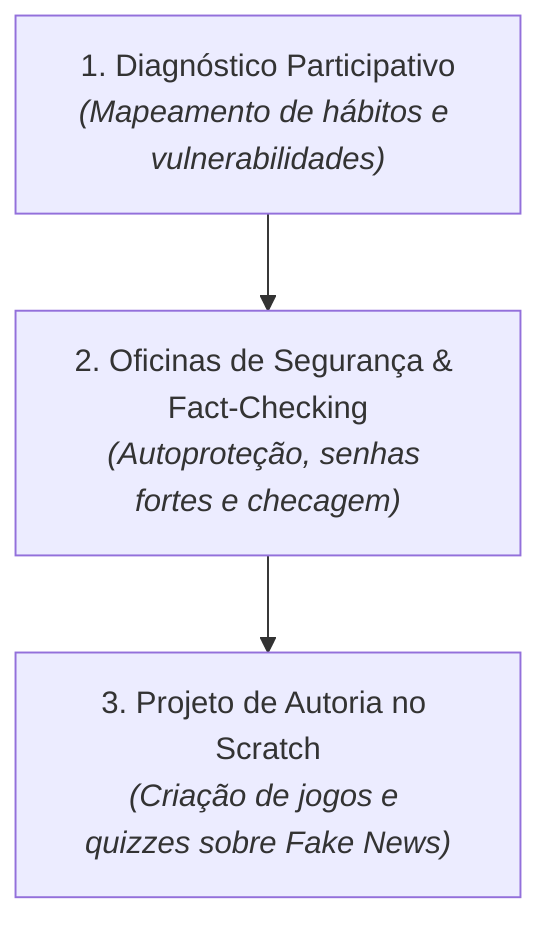

# 2 - Resolução do Desafio: Plano de Ação em Letramento Digital e Cidadania na Escola

> **Atividade:** Desafio da Semana 5 - Letramento Digital, BNCC e Cidadania  
> **Tema:** Desenvolvimento de Proposta Formativa em Cultura Digital e Segurança para Comunidade Escolar.

---

## 🎯 Proposta Estruturada de Intervenção

Para responder ao desafio proposto, estruturamos um **Plano de Ação em 3 Etapas Integradas**:

---

## 📝 Detalhamento do Plano de Ação

### 1. Diagnóstico da Comunidade Escolar
- **Cenário Identificado:** Alto índice de conectividade móvel via redes sociais, porém com baixa proficiência em pesquisa acadêmica, propagação ingênua de notícias sensacionalistas e senhas fracas compartilhadas.
- **Objetivo Geral:** Desenvolver a autonomia crítica e a responsabilidade ética no ecossistema digital.

### 2. Oficinas Práticas de Segurança e Fact-Checking
- **Módulo de Privacidade:** Compreensão da pegada digital (*digital footprint*) e parametrização de privacidade nas contas de redes sociais.
- **Metodologia dos 4 Passos contra Fake News:**
  1. *Checar a Fonte:* Verificar se o domínio é oficial ou se imita sites de notícias reais.
  2. *Buscar a Data Original:* Evitar tirar acontecimentos antigos de contexto.
  3. *Ler Além do Título:* Identificar manchetes sensacionalistas no modelo *clickbait*.
  4. *Consultar Agências de Checagem:* Usar agências públicas e REAs confiáveis.

### 3. Projeto Autoral de Programação Criativa
- **Atividade no Scratch:** Em duplas (aprendizagem entre pares), os estudantes desenvolvem um jogo de quiz interativo intitulado *"Detetive da Verdade"*, em que o jogador recebe manchetes e deve selecionar a atitude correta de checagem para ganhar pontos e avançar de fase.
- **Competências da BNCC Trabalhadas:** Pensamento Computacional (lógica condicional e variáveis), Mundo Digital (entendimento de redes) e Cultura Digital (ética e cidadania).

---

## 💬 Mensagem Pronta para o Fórum Temático

> **Título do Tópico:** Plano de Ação: Do Consumo Passivo à Autoria Crítica e Ética na Rede  
>
> Olá a todas e todos!  
> 
> A reflexão da Semana 5 evidencia que o papel da escola e da universidade não é ensinar a mexer em botões, mas formar a consciência crítica dos cidadãos digitais. A divisão em três eixos pela BNCC (Pensamento Computacional, Mundo Digital e Cultura Digital) é muito acertada porque une a técnica à ética.  
> 
> No plano que propus, a criação de jogos sobre *fact-checking* no Scratch une o raciocínio algorítmico à reflexão cidadã, permitindo que os estudantes sejam protagonistas na transformação de suas comunidades contra a desinformação.  
> 
> Um abraço e excelentes estudos a todos!
