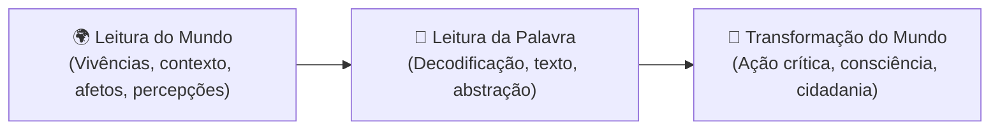

# 2 - Material-Base: A Importância do Ato de Ler (Paulo Freire)

> **Obra:** *A Importância do Ato de Ler em Três Artigos que se Completam*  
> **Autor:** Paulo Freire  
> **Editora:** Cortez Editora, São Paulo

---

## 📖 Síntese do Texto

Paulo Freire inicia seu ensaio resgatando as memórias de sua infância no Recife: o quintal de sua casa, as árvores, as cores dos pássaros, os animais, o murmúrio das águas e os sons dos trovões. Para o autor, esse universo sensorial constituía o seu primeiro "texto", o seu primeiro contexto existencial.

> *"A leitura do mundo precede a leitura da palavra, daí que a posterior leitura desta não possa prescindir da continuidade da leitura daquele. Linguagem e realidade se prendem dinamicamente."*

---

## 🔑 Principais Contribuições Conceituais

1. **A Leitura não é Depósito de Informação:** Ler não é um ato de memorização passiva de frases desconectadas (*educação bancária*), mas um diálogo vivo entre o leitor e o autor, mediado pelo mundo.
2. **A Palavra Grávida de Mundo:** Nenhuma palavra é neutra. Quando alguém lê ou escreve "árvore", "trabalho" ou "liberdade", toda a sua história pessoal e social ressoa nesse vocábulo.
3. **Compreensão Crítica vs Repetição Mecânica:** O leitor crítico não apenas aceita o que o texto diz, mas indaga sobre as intenções, os silêncios e as relações de poder subjacentes ao discurso.
