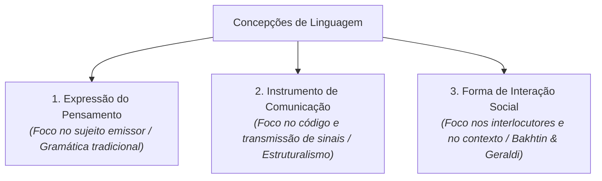

# Semana 2 - As Concepções de Linguagem e Interação

> **Disciplina:** Leitura e Produção de Textos (LET110)  
> **Carga Horária:** 80 horas (10h semanais)  
> **Bimestre:** 2026S2B1 - Univesp

---

Olá, estudante!

Boas-vindas à **Semana 2** da disciplina **Leitura e Produção de Textos (LET110)**!

Nesta semana, examinaremos as três grandes **concepções de linguagem** que moldaram o ensino e os estudos linguísticos no Ocidente:
1. **Linguagem como expressão do pensamento:** A visão tradicional/psicologista, na qual a linguagem é a manifestação exterior dos pensamentos individuais;
2. **Linguagem como instrumento de comunicação (ou código):** A visão estruturalista/informacional, em que a língua é um código neutro com emissor, receptor, canal e mensagem;
3. **Linguagem como forma de interação social (ou processo dialógico):** A visão sociointeracionista/discursiva (Bakhtin, Geraldi, Koch), onde a língua é uma prática viva, histórica e intersubjetiva que produz efeitos de sentido e relações de poder entre interlocutores.

Também debateremos as correntes do **Universalismo Linguístico** (Chomsky) versus **Determinismo Linguístico / Hipótese de Sapir-Whorf**.

---

## 🎯 Objetivos de aprendizagem

Ao final desta semana, você deverá ser capaz de:

- Identificar e contrastar as três principais concepções teóricas de linguagem;
- Compreender a linguagem como atividade sociointerativa, dialógica e ideológica;
- Diferenciar as hipóteses do Universalismo e do Relativismo/Determinismo Linguístico;
- Analisar como a concepção de linguagem adotada impacta a leitura de textos acadêmicos e profissionais;
- Refletir sobre os desafios culturais no aprendizado de línguas e na tradução de sentidos.

---

## 🏛️ As Três Concepções de Linguagem

---

## 🧩 Desafio da Semana: O Desafio da Alteridade Linguística

Considere a experiência de um estudante brasileiro iniciando o estudo de uma língua de matriz cultural e gramatical totalmente distinta (por exemplo, o coreano, o japonês ou o árabe):
1. **Relativismo Linguístico:** De que maneira estruturas gramaticais como graus de polidez obrigatórios refletem valores culturais da sociedade de origem?
2. **Concepções em Choque:** Ao tentar traduzir expressões culturais que não possuem equivalente direto no português, qual concepção de linguagem se mostra mais adequada: a linguagem como código fechado ou a linguagem como interação social situada?

---

## 🎥 Material-base: Videoaulas

### 🎬 Videoaula 3 - As Três Concepções de Linguagem
* **Docente Responsável:** Profa. Dra. Maria do Rosário Gregolin / Equipe Univesp
* **Tema:** Linguagem como expressão, código e interação dialógica (João Wanderley Geraldi e Bakhtin).
* **Resumo:** Apresentação comparativa das três visões, demonstrando como a passagem da visão prescritiva para a visão interacional transformou a leitura em um ato de coautoria de sentido.

### 🎬 Videoaula 4 - Universalismo e Relatividade Linguística
* **Docente Responsável:** Prof. Dr. Valdir Barzotto / Equipe Univesp
* **Tema:** Noam Chomsky e a gramática universal vs Edward Sapir e Benjamin Lee Whorf.
* **Resumo:** Discussão sobre se a linguagem molda a percepção da realidade (*Sapir-Whorf*) ou se todas as mentes humanas compartilham uma matriz biológica inata (*Universalismo Chomskiano*).

---

## 📚 Leituras Recomendadas

* **Texto-base:** *Concepções de Linguagem e Ensino de Português* (João Wanderley Geraldi). Ver resumo em [`2-Material-Base.md`](file:///home/henrique/Modelos/Univesp/2026S2B1/LET110-Leitura-e-Producao-de-Textos/Semana-2/2-Material-Base.md).
* **Texto Complementar:** *Ler e Compreender: Os Sentidos do Texto* (Ingedore Villaça Koch e Vanda Maria Elias). Ver detalhes em [`3-Texto-base.md`](file:///home/henrique/Modelos/Univesp/2026S2B1/LET110-Leitura-e-Producao-de-Textos/Semana-2/3-Texto-base.md).
