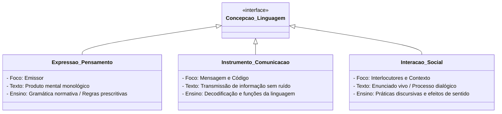

# 2 - Material-Base: Concepções de Linguagem e Prática Pedagógica (João Wanderley Geraldi)

> **Obra:** *O Texto na Sala de Aula* e *Portos de Passagem*  
> **Autor:** João Wanderley Geraldi (UNICAMP)  
> **Editora:** Martins Fontes / Ática

---

## 📖 As Três Concepções Sistematizadas por Geraldi

João Wanderley Geraldi revolucionou os estudos de linguística aplicada no Brasil ao demonstrar que toda prática de leitura e produção textual apoia-se, consciente ou inconscientemente, em uma concepção de linguagem:

---

## 🔑 Implicações para a Leitura e a Produção Textual

1. **Se a linguagem é interação**, o leitor não é um receptor passivo que apenas extrai um sentido pronto colocado pelo autor na folha de papel. O leitor é um **coautor** que mobiliza seu conhecimento de mundo, suas vivências e ideologias para reconstruir o sentido do texto.
2. **O texto deixa de ser um objeto estático** e passa a ser compreendido como um **evento comunicativo** historicamente determinado.
