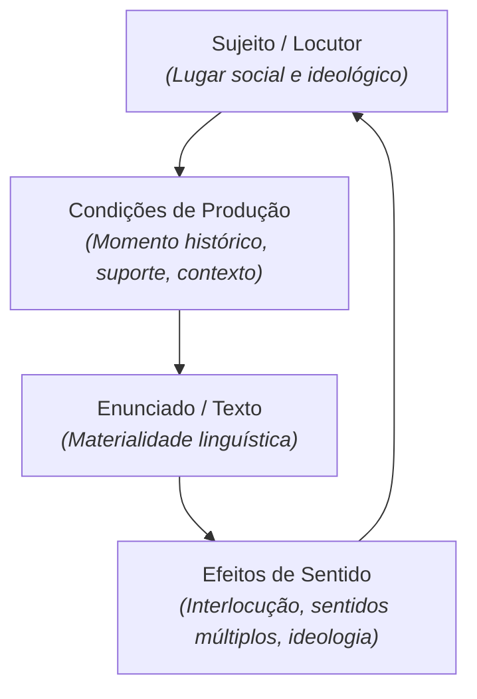

# Semana 3 - Discurso, Dialogismo e Interação Social

> **Disciplina:** Leitura e Produção de Textos (LET110)  
> **Carga Horária:** 80 horas (10h semanais)  
> **Bimestre:** 2026S2B1 - Univesp

---

Olá, estudante!

Boas-vindas à **Semana 3** da disciplina **Leitura e Produção de Textos (LET110)**!

Nesta semana, aprofundaremos os conceitos de **Discurso**, **Dialogismo** e **Polifonia**. Como nos ensina a Profa. **Eni Puccinelli Orlandi** na tradição da Análise do Discurso (AD), o discurso não é simplesmente a transmissão de palavras, mas a **produção de efeitos de sentido entre locutores**, indissociável de suas condições históricas, sociais e ideológicas.

Todo enunciado responde a enunciados anteriores e antecipa respostas futuras. Nenhum texto é uma ilha isolada: ele é habitado por múltiplas vozes sociais (polifonia) e reflete a posição social de quem fala.

---

## 🎯 Objetivos de aprendizagem

Ao final desta semana, você deverá ser capaz de:

- Definir o conceito de **Discurso** e diferenciá-lo de frase e texto;
- Compreender a noção de **Condições de Produção** do discurso (sujeitos, lugar social, momento histórico, contexto institucional);
- Analisar os conceitos de **Dialogismo** e **Polifonia** formulados pelo Círculo de Bakhtin;
- Identificar as vozes explícitas e implícitas que habitam textos jornalísticos, publicitários e acadêmicos;
- Reconhecer a intencionalidade discursiva e as relações de poder presentes na linguagem cotidiana.

---

## 🗣️ O Funcionamento do Discurso (Análise do Discurso)

---

## 🧩 Desafio da Semana: As Múltiplas Vozes em uma Notícia Polêmica

Analisar uma manchete e notícia de jornal sobre um tema de grande impacto social (por exemplo, inteligência artificial no mercado de trabalho ou reforma tributária):
1. **Identificação das Vozes (Polifonia):** Quais vozes sociais são citadas diretamente (especialistas, empresários, trabalhadores, governo) e quais vozes foram silenciadas?
2. **Condições de Produção:** Quem é o veículo emissor, qual é o perfil do leitor presumido e qual é o momento histórico da publicação?
3. **Efeitos de Sentido:** Quais palavras e adjetivos foram escolhidos para produzir determinados efeitos de sentido (ex.: "ameaça aos empregos" vs "avanço da produtividade")?

---

## 🎥 Material-base: Videoaulas

### 🎬 Videoaula 5 - Introdução à Análise do Discurso: Sujeito e Sentido
* **Docente Responsável:** Profa. Dra. Eni Orlandi / Equipe Univesp
* **Tema:** O que é discurso, condições de produção e o papel da ideologia.
* **Resumo:** A aula apresenta os fundamentos da Análise de Discurso de linha francesa, explicando como a língua faz sentido porque é atravessada pela história e pela ideologia.

### 🎬 Videoaula 6 - Dialogismo e Polifonia em Bakhtin
* **Docente Responsável:** Prof. Dr. Valdir Barzotto / Equipe Univesp
* **Tema:** Mikhail Bakhtin, o dialogismo como princípio fundamental da linguagem e a polifonia textual.
* **Resumo:** Discussão sobre como todo texto é tecido a partir de diálogos com outros textos, analisando o discurso direto, o discurso indireto e a ironia.

---

## 📚 Leituras Recomendadas

* **Texto-base:** *Análise de Discurso: Princípios e Procedimentos* (Eni P. Orlandi, Pontes Editores). Ver resumo em [`2-Material-Base.md`](file:///home/henrique/Modelos/Univesp/2026S2B1/LET110-Leitura-e-Producao-de-Textos/Semana-3/2-Material-Base.md).
* **Texto Complementar:** *Marxismo e Filosofia da Linguagem* (Mikhail Bakhtin / Valentin Volóchinov). Ver detalhes em [`3-Texto-base.md`](file:///home/henrique/Modelos/Univesp/2026S2B1/LET110-Leitura-e-Producao-de-Textos/Semana-3/3-Texto-base.md).
