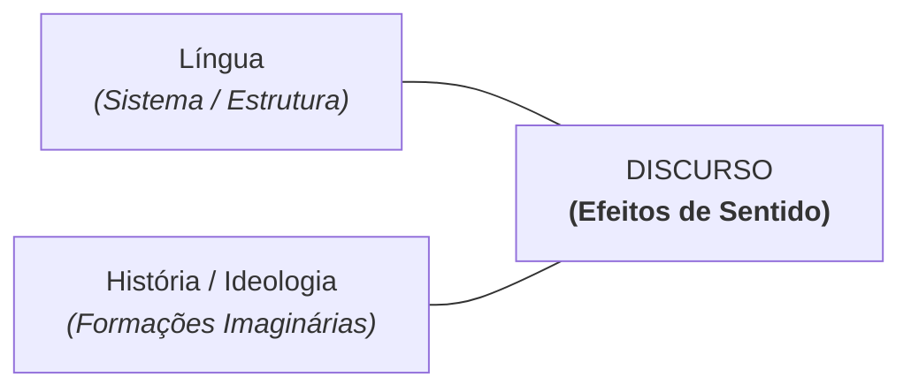

# 2 - Material-Base: Análise de Discurso (Eni Puccinelli Orlandi)

> **Obra:** *Análise de Discurso: Princípios e Procedimentos* (13ª Edição)  
> **Autora:** Eni Puccinelli Orlandi (UNICAMP / Laboratório de Estudos Urbanos)  
> **Editora:** Pontes Editores

---

## 📖 A Definição de Discurso

Para Eni Orlandi, a palavra *discurso* etimologicamente remete à ideia de "curso", "percurso", "correr por". Discurso é a palavra em movimento, a prática da linguagem articulada à vida social.

> *"O discurso é o lugar em que a língua e a história se encontram. Ele é o efeito de sentidos entre locutores."*

---

## 🔑 As Formações Imaginárias

Quando dois sujeitos conversam ou quando um autor escreve um texto para seus leitores, eles não operam com as identidades empíricas físicas, mas com **formações imaginárias**:
1. *Quem sou eu para lhe falar assim?* (A imagem que o locutor constrói de si mesmo);
2. *Quem é você para que eu lhe fale assim?* (A imagem que o locutor faz do seu interlocutor);
3. *De que estou falando?* (A imagem que se constrói do objeto do discurso).

A eficácia comunicativa e o poder de persuasão de qualquer texto dependem do ajuste preciso dessas formações imaginárias ao contexto institucional.
