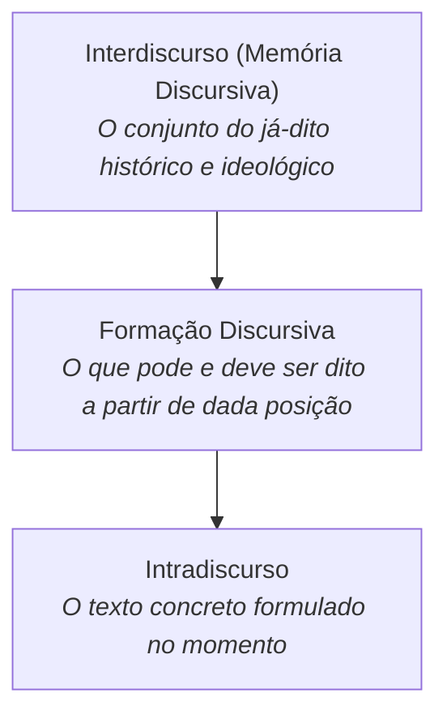

# 4 - Aprofundando o Tema: Interdiscurso e Memória Discursiva

> **Tema:** O Interdiscurso e a Memória Discursiva na Análise do Discurso  
> **Autores:** Michel Pêcheux e Eni Orlandi

---

## 🏛️ Interdiscurso: O Saber Já-Dito

Para a Análise do Discurso (AD), o **interdiscurso** (ou memória discursiva) é o conjunto de dizeres já produzidos e esquecidos ao longo da história que determinam aquilo que podemos e devemos dizer em determinada época.

### O Esquecimento Número 1 e 2 de Pêcheux:
- **Esquecimento nº 1:** O sujeito tem a ilusão de que é a fonte originária e única do que diz (esquece que suas palavras vêm do interdiscurso).
- **Esquecimento nº 2:** O sujeito tem a ilusão de que o sentido de suas palavras é transparente e unívoco (esquece que todo dizer poderia ser outro).
