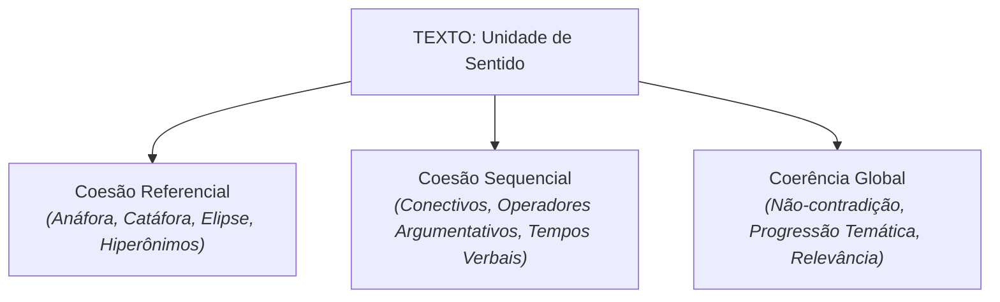

# Semana 4 - Coesão e Coerência Textual

> **Disciplina:** Leitura e Produção de Textos (LET110)  
> **Carga Horária:** 80 horas (10h semanais)  
> **Bimestre:** 2026S2B1 - Univesp

---

Olá, estudante!

Boas-vindas à **Semana 4** da disciplina **Leitura e Produção de Textos (LET110)**!

Nesta semana, estudaremos os dois pilares da **textualidade**: a **Coesão** e a **Coerência Textual**. 

Embora frequentemente citadas juntas, trata-se de dimensões distintas e complementares:
- **A Coesão** diz respeito à superfície linguística do texto, isto é, às conexões gramaticais, lexicais e sintáticas que amarram as palavras, orações e parágrafos entre si (coesão referencial e coesão sequencial).
- **A Coerência** diz respeito à profundidade do sentido global do texto, à sua inteligibilidade, consistência lógica, ausência de contradições internas e adequação pragmática ao contexto.

Como bem demonstra a linguista **Ingedore Koch**, um texto não é um mero amontoado de frases: ele é uma unidade orgânica de sentido tecida por mecanismos precisos de amarração e progressão temática.

---

## 🎯 Objetivos de aprendizagem

Ao final desta semana, você deverá ser capaz de:

- Diferenciar conceitualmente Coesão (superfície linguística) e Coerência (profundidade semântico-pragmática);
- Identificar e empregar os mecanismos de **Coesão Referencial** (anáfora, catáfora, elipse, sinonímia, hiperonímia e encapsulamento);
- Aplicar os operadores de **Coesão Sequencial** (conjunções aditivas, adversativas, conclusivas, causais e concessivas);
- Reconhecer os quatro princípios da Coerência Textual: **Continuidade**, **Progressão**, **Não-Contradição** e **Relevância**;
- Revisar e aprimorar textos acadêmicos, eliminando ambiguidades e rupturas de coerência.

---

## 🧩 Os Mecanismos de Textualidade

---

## 🧩 Desafio da Semana: Reescrita e Paráfrase com Foco em Coesão e Coerência

Considere o seguinte parágrafo desprovido de coesão formal e com repetições viciosas:
> *"O engenheiro chegou na obra. O engenheiro viu os problemas na obra. O engenheiro falou com os pedreiros. Os pedreiros não tinham materiais. Os materiais não chegaram na obra porque o caminhão quebrou na estrada. O engenheiro ficou nervoso porque a obra atrasou."*

**Atividade Proposta:**
1. Reescreva o trecho aplicando recursos de **coesão referencial** (pronomes, elipses/omissões subentendidas e termos genéricos/hiperônimos) para eliminar as repetições lexicais abusivas.
2. Empregue conectivos adequados de **coesão sequencial** para estabelecer relações de causa, consequência e tempo.
3. Elabore um breve comentário justificando as escolhas linguísticas adotadas na reescrita.

---

## 🎥 Material-base: Videoaulas

### 🎬 Videoaula 7 - Mecanismos de Coesão Referencial e Sequencial
* **Docente Responsável:** Profa. Dra. Ingedore Koch / Equipe Univesp
* **Tema:** Anáfora, catáfora, reiteração lexical e operadores argumentativos.
* **Resumo:** A aula detalha os expedientes de remissão a termos anteriores e posteriores no texto, demonstrando como pronomes e sinônimos mantêm o foco sem sobrecarregar a leitura.

### 🎬 Videoaula 8 - Coerência Textual e Construção de Sentido
* **Docente Responsável:** Prof. Dr. Valdir Barzotto / Equipe Univesp
* **Tema:** Princípios de não-contradição, progressão temática e contexto compartilhado.
* **Resumo:** Análise de como a coerência é construída na mente do leitor a partir de pistas linguísticas e conhecimentos prévios, abordando fatores de textualidade.

---

## 📚 Leituras Recomendadas

* **Texto-base:** *A Coesão Textual* (Ingedore Villaça Koch, Contexto). Ver resumo em [`2-Material-Base.md`](file:///home/henrique/Modelos/Univesp/2026S2B1/LET110-Leitura-e-Producao-de-Textos/Semana-4/2-Material-Base.md).
* **Texto Complementar:** *Lutar com Palavras: Coesão e Coerência* (Irandé Antunes, Parábola Editorial). Ver detalhes em [`3-Texto-base.md`](file:///home/henrique/Modelos/Univesp/2026S2B1/LET110-Leitura-e-Producao-de-Textos/Semana-4/3-Texto-base.md).
