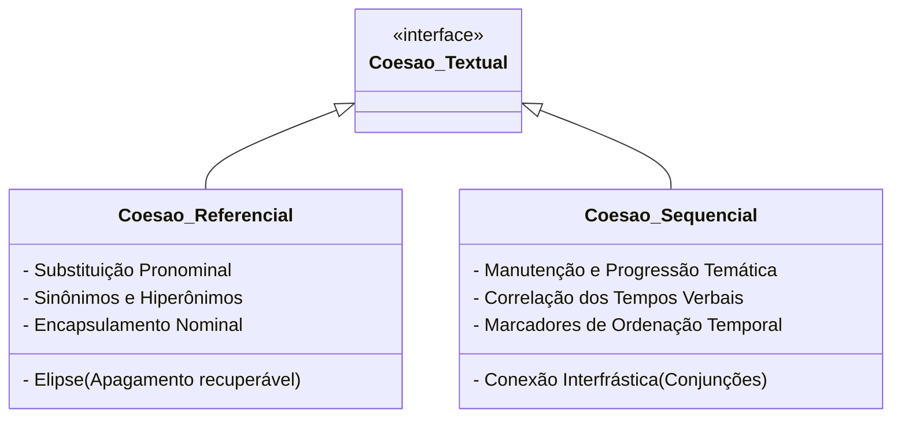

# 2 - Material-Base: A Coesão Textual (Ingedore Villaça Koch)

> **Obra:** *A Coesão Textual* (Coleção Repensando a Língua Portuguesa)  
> **Autora:** Ingedore Grunfeld Villaça Koch (UNICAMP)  
> **Editora:** Contexto

---

## 📖 A Coesão como Tecido Linguístico

Para Ingedore Koch, a palavra *texto* provém do latim *textum*, que significa "tecido", "entrelaçamento de fios". A coesão representa a forma como esses fios sintáticos e lexicais são entrelaçados para garantir a unidade de superfície do texto.

---

## 🔗 Tabela de Operadores Argumentativos e Relações Lógicas

| Relação Lógica | Conectivos / Operadores Principais | Exemplo de Aplicação |
| :--- | :--- | :--- |
| **Causalidade** | porque, visto que, já que, uma vez que, dado que | *O projeto atrasou visto que os insumos não foram entregues.* |
| **Conclusão** | portanto, logo, por conseguinte, dessarte, assim | *Os dados são consistentes; portanto, a hipótese foi validada.* |
| **Oposição / Adversidade** | mas, porém, contudo, todavia, no entanto, entretanto | *O modelo é veloz, porém consome mais memória.* |
| **Concessão** | embora, ainda que, mesmo que, conquanto, a despeito de | *Embora houvesse ruído no sinal, o algoritmo convergiu.* |
| **Adição / Conformidade** | além disso, outrossim; conforme, segundo, consoante | *Conforme demonstrado por Koch, a coesão estrutura o texto.* |
