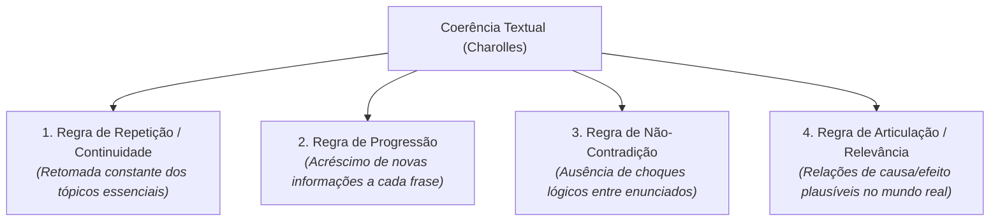

# 4 - Aprofundando o Tema: As Quatro Metarregras de Michel Charolles

> **Tema:** Princípios de Coerência Textual  
> **Autor:** Michel Charolles (Linguística Textual Francesa)

---

## 📐 As Quatro Metarregras de Coerência Textual

Michel Charolles estabeleceu quatro regras básicas para verificar se um texto é compreendido como coerente:

1. **Repetição / Continuidade:** É necessário que os elementos temáticos centrais sejam constantemente reintroduzidos através de pronomes e sinônimos.
2. **Progressão:** O texto não pode ficar girando em círculos (redundância); cada parágrafo deve acrescentar um dado ou raciocínio novo.
3. **Não-Contradição:** O autor não pode afirmar $A$ no início e depois dizer não-$A$ no final sem uma justificativa dialética.
4. **Articulação / Relevância:** Os fatos apresentados devem se relacionar de forma consistente com a lógica do mundo empírico ou com o universo ficcional proposto.
