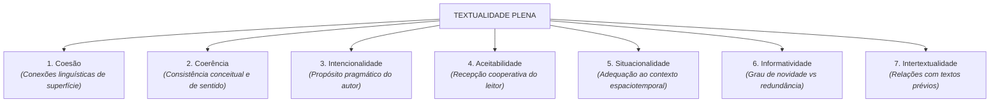

# Semana 5 - Informatividade, Intertextualidade e Fatores de Textualidade

> **Disciplina:** Leitura e Produção de Textos (LET110)  
> **Carga Horária:** 80 horas (10h semanais)  
> **Bimestre:** 2026S2B1 - Univesp

---

Olá, estudante!

Boas-vindas à **Semana 5** da disciplina **Leitura e Produção de Textos (LET110)**!

Nesta semana, exploraremos os critérios que transformam qualquer manifestação verbal em um texto autêntico e eficaz: os **Fatores de Textualidade**, formulados pelos linguistas **Robert-Alain de Beaugrande e Wolfgang Dressler**.

Dentre esses fatores, daremos ênfase especial à **Informatividade** (o equilíbrio entre o previsível e o inesperado, dividido em Graus 1, 2 e 3) e à **Intertextualidade** (o diálogo explícito ou implícito que todo texto estabelece com outros textos da cultura — por meio de citações, paráfrases, paródias, alusões e epígrafes).

---

## 🎯 Objetivos de aprendizagem

Ao final desta semana, você deverá ser capaz de:

- Identificar e analisar os **sete fatores de textualidade** de Beaugrande & Dressler;
- Compreender os três graus de **Informatividade** e calibrar o nível de novidade e previsibilidade de um texto acadêmico/profissional;
- Diferenciar as modalidades de **Intertextualidade**: Explícita (citação direta, referência bibliográfica) e Implícita (paródia, alusão, ironia);
- Reconhecer os papéis da **Intencionalidade**, **Aceitabilidade** e **Situacionalidade** na produção de efeitos de sentido;
- Evitar o clichê e o lugar-comum, elevando o valor informativo e a densidade argumentativa de suas produções textuais.

---

## 🏛️ Os Sete Fatores de Textualidade (Beaugrande & Dressler)

---

## 🧩 Desafio da Semana: Análise de Graus de Informatividade e Intertextualidade

Analisar dois textos contrastantes sobre o mesmo tema (por exemplo, sustentabilidade energética):
1. **Texto A (Grau 1 de Informatividade):** Composto quase exclusivamente por lugares-comuns e clichês previsíveis (*"A energia é importante para o mundo. Devemos economizar para o futuro."*).
2. **Texto B (Grau 2/3 de Informatividade):** Articulado com dados técnicos atualizados, terminologia especializada e referências intertextuais explícitas a relatórios da ONU e cientistas da área.
3. Identifique como a dosagem adequada de informatividade mantém o leitor interessado sem tornar o texto hermético ou inacessível.

---

## 🎥 Material-base: Videoaulas

### 🎬 Videoaula 9 - Os Sete Fatores de Textualidade
* **Docente Responsável:** Profa. Dra. Maria do Rosário Gregolin / Equipe Univesp
* **Tema:** Beaugrande & Dressler: a construção da textualidade no evento comunicativo.
* **Resumo:** Apresentação detalhada dos 7 critérios, mostrando como a ausência de situacionalidade ou informatividade compromete a eficácia comunicativa.

### 🎬 Videoaula 10 - Informatividade e Intertextualidade na Produção Textual
* **Docente Responsável:** Prof. Dr. Valdir Barzotto / Equipe Univesp
* **Tema:** Níveis de informatividade (1, 2 e 3), citação acadêmica, paródia e paráfrase.
* **Resumo:** Análise de como a intertextualidade enriquece a produção escrita e como calibrar o grau de informatividade para diferentes públicos.

---

## 📚 Leituras Recomendadas

* **Texto-base:** *Introdução à Linguística Textual* (Ingedore Koch, Martins Fontes). Ver resumo em [`2-Material-Base.md`](file:///home/henrique/Modelos/Univesp/2026S2B1/LET110-Leitura-e-Producao-de-Textos/Semana-5/2-Material-Base.md).
* **Texto Complementar:** *Intertextualidade: Teoria e Prática* (Ingedore Koch, Anna Christina Bentes e Luiz Carlos Cavalcante). Ver detalhes em [`3-Texto-base.md`](file:///home/henrique/Modelos/Univesp/2026S2B1/LET110-Leitura-e-Producao-de-Textos/Semana-5/3-Texto-base.md).
