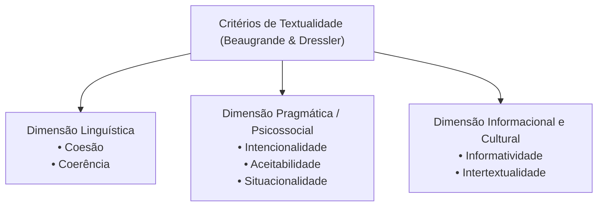

# 2 - Material-Base: Introdução à Linguística Textual (Ingedore Koch)

> **Obra:** *Introdução à Linguística Textual: Trajetória e Grandes Temas*  
> **Autora:** Ingedore Villaça Koch  
> **Editora:** Martins Fontes

---

## 📖 Da Frase ao Texto: O Nascimento da Linguística Textual

A Linguística Textual surgiu a partir da constatação de que as teorias linguísticas restritas à análise de frases isoladas eram incapazes de explicar fenômenos discursivos complexos como a ironia, a ambiguidade contextual, a anáfora de longa distância e a construção da textualidade.

---

## 🔍 Os Fatores Pragmáticos em Detalhe

1. **Intencionalidade:** O empenho do autor em construir um texto coeso e coerente capaz de atingir seus objetivos comunicativos (informar, convencer, emocionar, ordenar).
2. **Aceitabilidade:** A disposição cooperativa do leitor/ouvinte em esperar que o texto faça sentido e em despender esforço interpretativo para preencher lacunas.
3. **Situacionalidade:** O conjunto de fatores que tornam um texto relevante e adequado para dada situação comunicativa (ex.: uma placa na estrada *"Rua Sem Saída"* só faz sentido naquele local específico).
