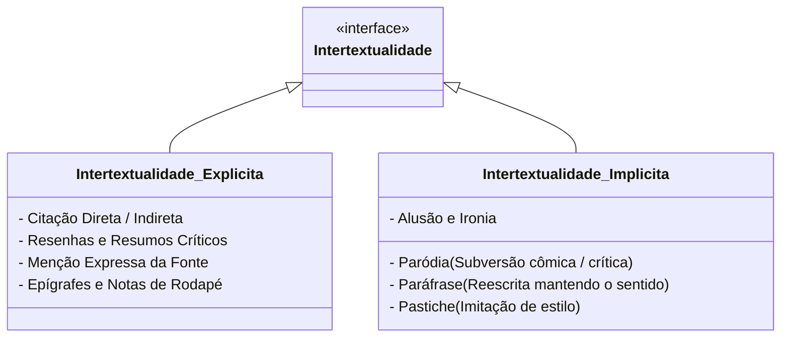

# 3 - Texto-base: Intertextualidade - Teoria e Prática (Koch, Bentes & Cavalcante)

> **Obra:** *Intertextualidade: Diálogos Possíveis*  
> **Autoras:** Ingedore Koch, Anna Christina Bentes e Mônica Cavalcante  
> **Editora:** Cortez Editora

---

## 📖 Modalidades de Intertextualidade

A intertextualidade ocorre quando a produção ou recepção de um texto depende do conhecimento prévio de outro texto (o hipotexto).

---

## 🎭 Paródia vs Paráfrase

- **Paráfrase:** Ocorre quando um texto retoma as ideias essenciais de outro texto, mantendo a orientação argumentativa original, mas alterando a formulação léxico-sintática (muito usada em artigos científicos para citar autores).
- **Paródia:** Ocorre quando um texto retoma a estrutura formal de outro texto com o objetivo de subverter seu sentido original, provocando humor, crítica social ou reflexão irônica (muito usada em tirinhas, memes e sátiras políticas).
