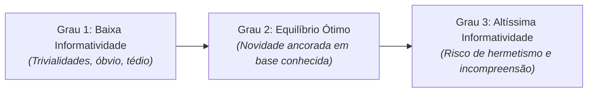

# 4 - Aprofundando o Tema: Calibragem de Informatividade na Escrita Científica

> **Tema:** O Princípio da Informatividade na Produção Textual Acadêmica  
> **Autores:** Ingedore Koch e Vanda Maria Elias

---

## ⚖️ A Dosagem Ideal da Informatividade

A informatividade diz respeito à quantidade de informação nova (não previsível) veiculada pelo texto:

### Dicas para a Escrita Universitária:
1. **Evitar o Grau 1:** Iniciar um artigo de engenharia ou computação dizendo que *"a tecnologia é muito importante hoje em dia"* desvaloriza o trabalho; substitua por dados quantitativos ou problemáticas concretas.
2. **Construir o Grau 2:** Apresente os conceitos conhecidos da disciplina como ponto de partida e, em seguida, introduza as inovações, experimentos e resultados novos.
3. **Cuidado com o Grau 3 sem Mediação:** Caso use conceitos matemáticos ou termos técnicos extremamente avançados, defina-os previamente para garantir a aceitabilidade pelo leitor.
