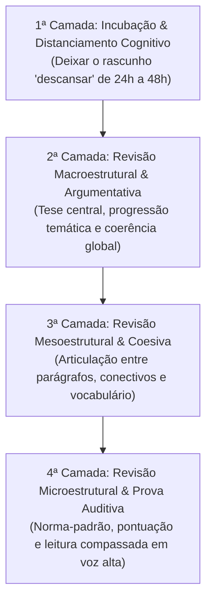

# S7 - Fórum Temático: Roteiro de Autocorreção e Revisão Textual

> **Atividade:** Fórum Temático / Desafio da Semana 7  
> **Disciplina:** Leitura e Produção de Textos (LET110)  
> **Tema:** Táticas de Revisão, Reescrita e Roteiro de Autocorreção Autoral  
> **Docente Responsável:** Profa. Dra. Filomena Elaine Paiva Assolini

---

## 📌 Enunciado Oficial do Fórum Temático

> *"Neste fórum, convidamos você a compartilhar com colegas um roteiro de revisão de seus próprios textos. A ideia é que você descreva em detalhes cada uma das etapas de revisão que você seguiria para avaliar a própria escrita. Se quiser, pode informar se as etapas seriam seguidas em todas as versões ou somente em algumas. É comum, por exemplo, que façamos algumas operações somente nas versões iniciais do texto, como a verificação da clareza e da comunicabilidade. Assim, as revisões das últimas etapas podem ficar restritas à checagem de problemas ortográficos e/ou gramaticais. Veja o que funciona melhor para seus próprios textos. Estimula-se, assim, seu autoconhecimento como escritor."*

---

## 🔗 Articulação Pedagógica: Desafio, Videoaulas e Fórum

O Fórum Temático e o Desafio da Semana 7 operam em perfeita sintonia:

1. **No Desafio:** Pratica-se a *produção autoral* de um comentário interpretativo acadêmico em 5 etapas a partir de um texto-base do curso (conforme ensinado pelo Prof. Dr. Marcus Sacrini).
2. **Nas Videoaulas (13, 14 e 15):** A Profa. Dra. Vanessa Martins do Monte e o Prof. Dr. Valdir Barzotto demonstram que *"um texto se escreve reescrevendo"*, desmistificando o mito da escrita espontânea e valorizando a reelaboração contínua.
3. **No Fórum Temático:** Formaliza-se a *metacognição do escritor*, ou seja, o roteiro prático e consciente que organiza as sucessivas versões de um texto até a sua entrega final.

---

## 🧭 Roteiro Sistemático de Revisão e Reescrita em Quatro Camadas

---

### 📋 Detalhamento Operacional das Etapas:

#### 1. Camada 1 — Incubação e Distanciamento Cognitivo (*Rascunho -> Versão 2*)
- **Ação:** Interrupção do contato visual e mental com o texto por um período mínimo de 24 a 48 horas.
- **Fundamento:** Eliminar da memória do autor a intenção prévia de escrita, permitindo que ele retorne ao texto com o olhar isento e crítico de um leitor externo.

#### 2. Camada 2 — Revisão Macroestrutural e Coerência Global (*Versão 2*)
- **Foco:** Conteúdo, arquitetura lógica e adequação ao gênero discursivo.
- **Checklist de avaliação:**
  - A tese/ideia central está nitidamente formulada no início?
  - A progressão temática é fluida ou há saltos conceituais e lacunas?
  - Os argumentos apresentados realmente sustentam o ponto de vista sem contradições?
  - Eliminar, fundir ou reescrever blocos de parágrafos quando necessário.

#### 3. Camada 3 — Revisão Mesoestrutural e Coesão Textual (*Versão 3*)
- **Foco:** Conexões inter e intraparágrafos, operadores argumentativos e precisão lexical.
- **Checklist de avaliação:**
  - Os conectivos utilizados expressam com exatidão a relação de sentido pretendida (adição, oposição, causa, conclusão)?
  - Há repetições desnecessárias que possam ser sanadas com pronomes, elipses ou sinônimos?
  - O registro linguístico está devidamente adequado à esfera acadêmica formal?

#### 4. Camada 4 — Revisão Microestrutural e Teste Auditivo (*Versão Final*)
- **Foco:** Norma-padrão gramatical, pontuação e ritmo sintático.
- **Checklist de avaliação:**
  - Concordância verbal/nominal, regência e aplicação rigorosa da pontuação (vírgulas e crases).
  - **Tática da Leitura em Voz Alta:** Leitura atenta e audível para detectar truncamentos sintáticos, frases excessivamente longas e problemas de respiração/fluidez.

---

## 💬 Sugestão de Postagem para o Fórum Temático (Pronta para Envio)

> **Título da Postagem:** *A Escrita como Processo: Meu Roteiro de Revisão em Quatro Camadas para Produções Futuras*
>
> Olá a todos, colegas e professores!
>
> As discussões desta semana sobre autocorreção e a premissa de que *"um texto se escreve reescrevendo"* (apresentada pela Profa. Vanessa Martins do Monte) provocaram uma grande mudança na minha percepção sobre a produção escrita. Muitas vezes temos a tendência de tratar a primeira versão de um texto como se fosse a entrega final, fazendo apenas ajustes pontuais de ortografia.
>
> A partir dos aprendizados desta aula e das reflexões sobre o distanciamento do autor, estruturei um **roteiro sistemático de revisão em quatro etapas** que passarei a adotar como método oficial em todas as minhas produções acadêmicas e profissionais daqui para frente:
>
> **1. Primeira Etapa — O Distanciamento Cognitivo (Incubação do Rascunho):**  
> Ao concluir a primeira versão bruta (o rascunho), passarei a deixar o texto "descansar" de 24 a 48 horas antes de qualquer leitura. O objetivo que pretendo atingir com isso é desvincular minha mente daquilo que eu *pretendia* escrever, possibilitando que eu volte ao texto no dia seguinte assumindo a postura isenta e crítica de um leitor externo.
>
> **2. Segunda Etapa — Revisão Macroestrutural e Coerência Global (Versão 2):**  
> Nessa segunda passagem, não pretendo me preocupar com detalhes de pontuação ou gramática. O foco exclusivo será na solidez estrutural:
> - A tese ou ideia central está clara e bem delimitada desde o parágrafo de abertura?
> - A progressão temática entre os parágrafos faz sentido lógico?
> - Os argumentos realmente sustentam a tese ou há desvios de foco?
> - Se necessário, pretendo reordenar, fundir ou até reescrever parágrafos inteiros.
>
> **3. Terceira Etapa — Revisão Mesoestrutural e Coesão Textual (Versão 3):**  
> Uma vez validada a arquitetura lógica das ideias, vou refinar a articulação e a fluidez do texto:
> - Avaliar o uso dos operadores argumentativos e conectivos de transição (aditivos, explicativos, conclusivos).
> - Eliminar repetições e redundâncias lexicais por meio de recursos de coesão (pronomes, elipses, sinônimos).
> - Garantir a precisão conceitual e a adequação ao registro acadêmico formal.
>
> **4. Quarta Etapa — Revisão Microestrutural e Teste Auditivo (Versão Final):**  
> Somente nesta última etapa farei a depuração normativa e mecânica:
> - Revisão minuciosa de ortografia, concordância, regência e pontuação (atenção especial a vírgulas e crases).
> - **Tática da Leitura em Voz Alta:** Adotarei a leitura compassada em voz alta de todo o texto. Esse teste auditivo será essencial para identificar períodos longos, problemas de respiração/ritmo ou frases truncadas.
>
> Para tornar esse processo palpável, pretendo utilizar ativamente o histórico de versões e marcações do editor de texto digital (como Google Docs), salvando e nomeando cada versão intermediária para acompanhar a evolução do texto.
>
> O que acharam dessa proposta de roteiro? Pretendem incluir alguma etapa parecida na rotina de escrita de vocês?
>
> Um abraço e ótimos estudos a todos!

---

## 📝 Versão em Formato Dissertativo-Argumentativo

### **Título:** O Artesanato da Escrita: A Metacognição e a Reescrita como Pilares da Autonomia Autoral

Na tradição do senso comum, a habilidade de escrever com clareza é frequentemente concebida como um dom inato ou um ato de inspiração instantânea. No entanto, os estudos contemporâneos sobre letramento e produção textual demonstram que a escrita acadêmica e profissional constitui um trabalho artesanal, processual e recursivo. Escrever não se resume a verter pensamentos prontos no papel; trata-se, fundamentalmente, de um processo de descoberta e refinamento no qual a reescrita assume papel central. Nesse cenário, o desenvolvimento de um roteiro metódico de autocorreção em múltiplas camadas revela-se a estratégia mais eficaz para garantir a coerência, a coesão e a precisão comunicativa de qualquer texto.

Em primeiro lugar, a eficácia do processo de revisão apoia-se no princípio do distanciamento cognitivo. Imediatamente após redigir a primeira versão, o autor encontra-se impregnado pelas ideias que pretendia veicular, o que cria pontos cegos e impede a identificação de ambiguidades, lacunas argumentativas e raciocínios truncados. Ao conceder um período de descanso ao rascunho — permitindo que o texto "adormeça" —, o escritor desconecta sua percepção subjetiva das palavras impressas. Ao retomar o manuscrito no dia seguinte, ele é capaz de assumir a postura desinteressada e rigorosa do leitor destinatário, avaliando com neutralidade se as proposições estão realmente expressas no texto de forma autônoma e inteligível.

Em segundo lugar, a estruturação hierárquica da revisão — dividida em etapas macro, meso e microestruturais — otimiza a carga cognitiva e potencializa a qualidade do produto final. Tentar corrigir pontuação e grafia simultaneamente à avaliação da tese central resulta em dispersão e ineficiência. Nas fases iniciais, a atenção deve recair sobre a solidez da argumentação e a progressão temática global. Somente após a consolidação da arquitetura do texto torna-se produtivo refinar os elementos de coesão sequencial e referencial, finalizando o ciclo com a depuração gramatical e o teste de leitura em voz alta, indispensável para calibrar o ritmo sintático. O recurso aos históricos de versão digital atua, nesse contexto, como um registro tangível da evolução do pensamento e da maturação da autoria.

Conclui-se, portanto, que a incorporação sistemática de um roteiro de reescrita transforma a relação do indivíduo com a linguagem escrita. A autocorreção consciente liberta o estudante da ilusão da perfeição na primeira tentativa, convertendo o erro e o rascunho em instrumentos formativos de aprendizado contínuo. Ao dominar táticas de distanciamento, checagem estrutural e polimento linguístico, o autor desenvolve autêntica autonomia intelectual, capacitando-se a produzir textos acadêmicos rigorosos, persuasivos e plenamente adequados às exigências da sociedade do conhecimento.
