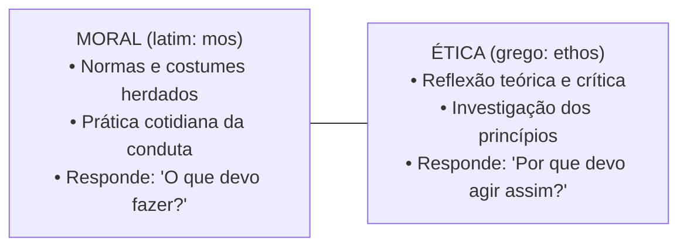

# Semana 1 - Introdução à Ética e Moral

> **Disciplina:** Ética, Cidadania e Sociedade (SOC100)  
> **Carga Horária:** 40 horas  
> **Bimestre:** 2026S2B1 - Univesp

---

Olá, estudante!

Boas-vindas à **Semana 1** da disciplina **Ética, Cidadania e Sociedade (SOC100)**!

Nesta semana introdutória, estabeleceremos as bases filosóficas fundamentais para compreender o que é o agir ético. Frequentemente usadas como sinônimos no senso comum, as palavras **Ética** e **Moral** possuem raízes e alcances teóricos distintos:
- **Moral** (do latim *mos, moris*, costume): Conjunto de normas, valores, regras e tabus historicamente construídos e aceitos por um determinado grupo social ou comunidade para regular o comportamento cotidiano.
- **Ética** (do grego *ethos*, morada, caráter, modo de ser): Reflexão filosófica crítica e racional sobre a validade, legitimidade e fundamentos dos sistemas morais.

Também investigaremos a diferença entre **Juízos de Fato** (que descrevem como a realidade *é*) e **Juízos de Valor** (que avaliam como a realidade *deve ser*).

---

## 🎯 Objetivos de aprendizagem

Ao final desta semana, você deverá ser capaz de:

- Definir e distinguir com rigor conceitual os termos **Ética** e **Moral**;
- Compreender a etimologia e as origens histórico-filosóficas de *ethos* e *mos*;
- Diferenciar **Juízos de Fato** de **Juízos de Valor**;
- Analisar a relação entre liberdade, consciência moral e responsabilidade individual/coletiva;
- Reconhecer o papel da reflexão ética na formação cidadã e profissional contemporânea.

---

## ⚖️ A Distinção entre Moral e Ética

---

## 🧩 Desafio da Semana: O Dilema da Carteira Encontrada

Imagine a seguinte situação-problema:  
*Um cidadão encontra uma carteira caída no chão de uma agência bancária lotada, contendo documentos pessoais, cartões e R$ 2.000,00 em dinheiro em espécie. Ninguém viu quando a carteira caiu.*

**Questões para Reflexão:**
1. Qual é a diferença entre uma ação motivada apenas pelo medo da punição externa (sanção legal/moral) e uma ação motivada pela consciência ética autônoma?
2. Em termos éticos, por que devolver a carteira com o dinheiro ao legítimo dono é uma exigência de integridade, mesmo quando há certeza de impunidade absoluta?
3. Como os juízos de fato e de valor se manifestam na deliberação desse dilema?

---

## 🎥 Material-base: Videoaulas

### 🎬 Videoaula 1 - O que é Ética e o que é Moral?
* **Docente Responsável:** Prof. Dr. Sílvio Gallo / Equipe Univesp
* **Tema:** Etimologia, costumes, normas sociais e a emergência da reflexão filosófica.
* **Resumo:** A aula aborda a gênese da vida moral nas sociedades humanas e explica por que a ética surge quando a comunidade passa a questionar criticamente suas próprias tradições herdadas.

### 🎬 Videoaula 2 - Juízos de Fato e Juízos de Valor
* **Docente Responsável:** Profa. Dra. Marilena Chauí / Equipe Univesp
* **Tema:** A distinção entre descrever o mundo empírico e avaliar axiologicamente as condutas humanas.
* **Resumo:** Explicação minuciosa sobre como os juízos de valor atribuem qualidades morais (bom/mau, justo/injusto, digno/indigno) às ações e escolhas humanas.

---

## 📚 Leituras Recomendadas

* **Texto-base 1:** *Ética e Cidadania: Caminhos da Filosofia* (Sílvio Gallo). Ver resumo em [`1-Texto-base.md`](file:///home/henrique/Modelos/Univesp/2026S2B1/SOC100-Etica-Cidadania-e-Sociedade/Semana-1/1-Texto-base.md).
* **Texto-base 2:** *Convite à Filosofia - O Universo Moral* (Marilena Chauí). Ver resumo em [`2-Texto-base.md`](file:///home/henrique/Modelos/Univesp/2026S2B1/SOC100-Etica-Cidadania-e-Sociedade/Semana-1/2-Texto-base.md).
