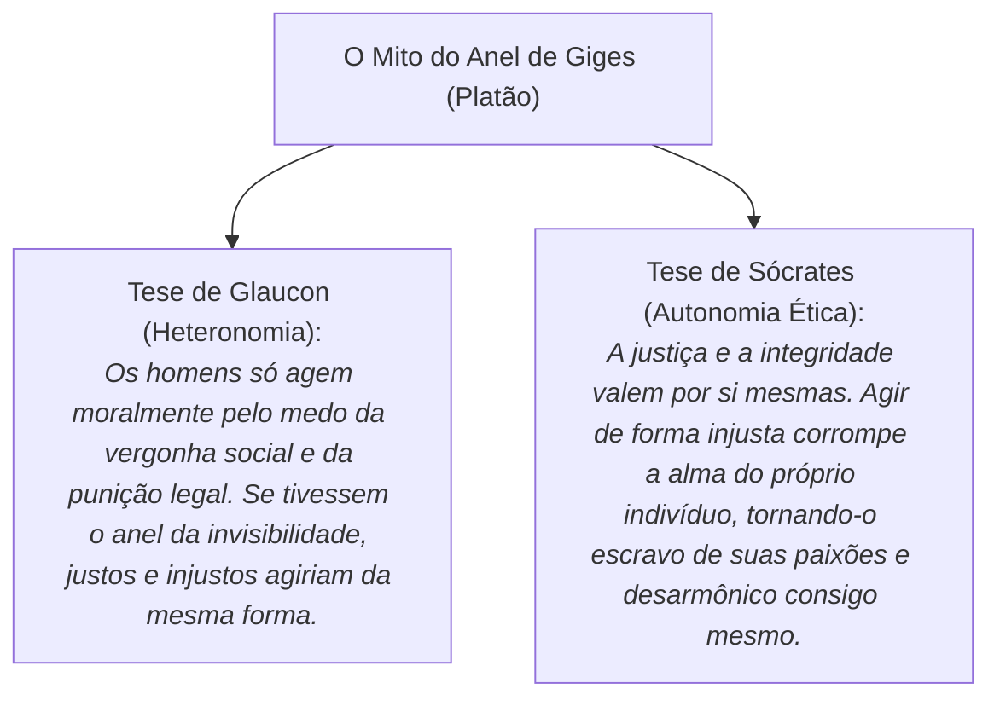

# 4 - Aprofundando o Tema: O Anel de Giges e o Dilema da Impunidade

> **Obra de Referência:** *A República* (Livro II - O Mito do Anel de Giges)  
> **Autor:** Platão (Diálogos Platônicos)

---

## 💍 O Mito do Anel de Giges

No Livro II de *A República*, o personagem Glaucon propõe a Sócrates um experimento mental radical:
- Um pastor chamado Giges encontra uma tumba subterrânea com um cavalo de bronze, no qual havia um cadáver usando um anel de ouro.
- Giges coloca o anel e descobre que, ao girar o engaste da joia para dentro da palma da mão, ele se torna **completamente invisível** aos olhos de todos.
- De posse desse poder de invisibilidade e de impunidade absoluta, Giges seduz a rainha, assassina o rei da Lídia e usurpa o trono.

---

## 🎯 Lição Filosófica para a Vida Cidadã e Profissional

O mito do anel de Giges formula a questão definitiva da ética: **Como você se comporta quando tem a certeza absoluta de que ninguém está olhando?**

Ser ético significa que a sua integridade independe de câmeras de vigilância, auditorias fiscais ou sanções policiais; é o compromisso interno e consciente com a dignidade humana.
