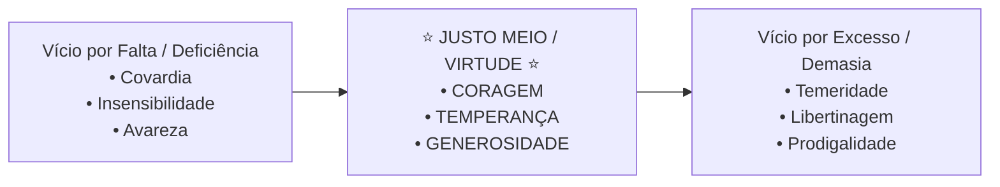

# Semana 2 - Ética na Antiguidade e Idade Média: As Virtudes e o Justo Meio

> **Disciplina:** Ética, Cidadania e Sociedade (SOC100)  
> **Carga Horária:** 40 horas  
> **Bimestre:** 2026S2B1 - Univesp

---

Olá, estudante!

Boas-vindas à **Semana 2** da disciplina **Ética, Cidadania e Sociedade (SOC100)**!

Nesta semana, faremos uma viagem às origens históricas do pensamento ético ocidental na Grécia Antiga e no período Medieval. Investigaremos como os filósofos clássicos conceberam o bem viver:
- **Sócrates:** O intelectualismo moral — quem conhece verdadeiramente o Bem não comete o mal voluntariamente;
- **Platão:** A justiça como harmonia da alma tripartite (racional, irascível e concupiscível) refletida na organização justa da Pólis;
- **Aristóteles:** A **Ética das Virtudes** (*Ética a Nicômaco*), a busca da felicidade plena (**Eudaimonia**) e a famosa **Doutrina do Justo Meio** (*Mesótes*);
- **Filosofia Medieval (Agostinho e Tomás de Aquino):** A cristianização da ética aristotélica e platônica, onde a virtude culmina na beatitude divina e no amor ao próximo.

---

## 🎯 Objetivos de aprendizagem

Ao final desta semana, você deverá ser capaz de:

- Compreender a concepção socrático-platônica de virtude, justiça e conhecimento;
- Analisar a teoria ética de Aristóteles na obra *Ética a Nicômaco*, definindo **Eudaimonia** e **Virtude Moral**;
- Aplicar o conceito aristotélico de **Justo Meio (Mediana)** como equilíbrio entre o excesso e a falta;
- Identificar as transformações do pensamento ético na Idade Média (Agostinho e Tomás de Aquino);
- Relacionar o cultivo de hábitos virtuosos com a conduta profissional no mundo contemporâneo.

---

## 🏛️ A Teoria Aristotélica do Justo Meio (*Mesótes*)

---

## 🧩 Desafio da Semana: A Tomada de Decisão sob Pressão e a Coragem Aristotélica

Considere a seguinte situação profissional:  
*Um engenheiro júnior identifica uma falha crítica de segurança no projeto de um viaduto sob a responsabilidade de sua diretoria. Ele é pressionado a assinar a liberação da obra sem as correções devidas para evitar multas contratuais.*

**Questões para Reflexão:**
1. Sob a perspectiva da Ética a Nicômaco, como o conceito de **Coragem** se diferencia da **Covardia** (calar-se por medo de demissão) e da **Temeridade** (fazer denúncias precipitadas sem provas técnicas fundamentadas)?
2. Como a prudência (*Frônesis*) atua como a virtude intelectual mestra para encontrar o justo meio nessa crise ética?

---

## 🎥 Material-base: Videoaulas

### 🎬 Videoaula 3 - A Ética das Virtudes em Aristóteles: Eudaimonia e Justo Meio
* **Docente Responsável:** Prof. Dr. Sílvio Gallo / Equipe Univesp
* **Tema:** *Ética a Nicômaco*, a felicidade como fim supremo da ação humana e a prática habitual das virtudes.
* **Resumo:** Apresentação da teleologia aristotélica, demonstrando que a virtude não é uma teoria abstrata, mas um hábito prático adquirido pela repetição (*hexis*).

### 🎬 Videoaula 4 - Da Pólis Grega à Teologia Medieval: Agostinho e Tomás de Aquino
* **Docente Responsável:** Equipe Univesp
* **Tema:** O livre-arbítrio em Santo Agostinho e a lei natural em São Tomás de Aquino.
* **Resumo:** Análise de como a tradição cristã integrou a sabedoria grega com a revelação bíblica, situando a graça divina e a caridade como cúpula da vida moral.

---

## 📚 Leituras Recomendadas

* **Texto-base 1:** *Ética a Nicômaco* (Aristóteles - Livros I e II). Ver resumo em [`1-Texto-base.md`](file:///home/henrique/Modelos/Univesp/2026S2B1/SOC100-Etica-Cidadania-e-Sociedade/Semana-2/1-Texto-base.md).
* **Texto-base 2:** *História da Filosofia: Dos Gregos à Idade Média* (Giovanni Reale e Dario Antiseri). Ver resumo em [`2-Texto-base.md`](file:///home/henrique/Modelos/Univesp/2026S2B1/SOC100-Etica-Cidadania-e-Sociedade/Semana-2/2-Texto-base.md).
