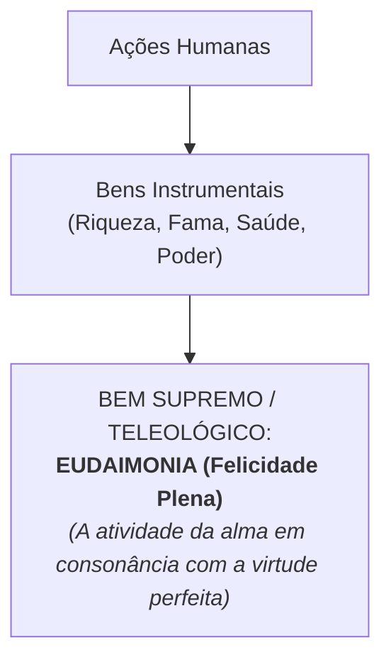

# 1 - Texto-base: A Ética a Nicômaco (Aristóteles)

> **Obra:** *Ética a Nicômaco* (Livros I e II: O Bem Supremo e a Natureza da Virtude)  
> **Autor:** Aristóteles (384 a.C. – 322 a.C.)  
> **Tradução:** Coleção Os Pensadores / Edipro

---

## 📖 A Felicidade (*Eudaimonia*) como Fim Supremo

Para Aristóteles, toda arte, investigação, ação e escolha humana visa a um determinado bem. No entanto, muitos bens são apenas instrumentais (o dinheiro serve para comprar coisas; a medicina serve para curar doenças).

Qual é o único bem que é desejado por si mesmo e nunca em função de outra coisa? 
Aristóteles responde: a **Eudaimonia** (Felicidade / Florescimento Humano).

---

## ⚖️ A Virtude Ética e a Doutrina do Justo Meio

Aristóteles ensina que a **virtude moral** (*aretê*) não é um dom inato e nem uma emoção passageira, mas uma **disposição de caráter adquirida pelo hábito** (*hexis*). Nós nos tornamos justos praticando atos de justiça; nos tornamos corajosos praticando atos de coragem.

A virtude é o ponto de equilíbrio equidistante entre dois extremos viciosos:
$$\text{Virtude} = \text{Justo Meio} \ (\text{nem deficiência, nem excesso})$$

- **Covardia (Falta)** $\leftrightarrow$ **CORAGEM (Virtude)** $\leftrightarrow$ **Temeridade (Excesso)**
- **Avareza (Falta)** $\leftrightarrow$ **GENEROSIDADE (Virtude)** $\leftrightarrow$ **Prodigalidade (Excesso)**
- **Insensibilidade (Falta)** $\leftrightarrow$ **TEMPERANÇA (Virtude)** $\leftrightarrow$ **Libertinagem (Excesso)**
- **Desdém (Falta)** $\leftrightarrow$ **JUSTIÇA (Virtude)** $\leftrightarrow$ **Ganância (Excesso)**
