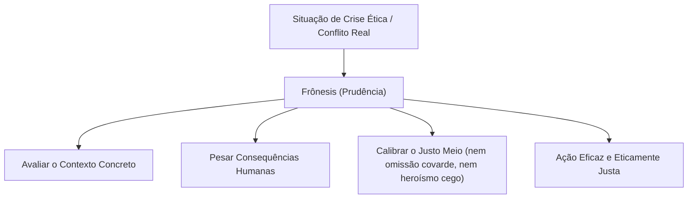

# 4 - Aprofundando o Tema: A Prudência (*Phrónesis*) e a Tomada de Decisão Profissional

> **Tema:** A Sabedoria Prática Aristotélica na Vida Contemporânea  
> **Referência:** Hans-Georg Gadamer (*Verdade e Método*) e Pierre Aubenque (*A Prudência em Aristóteles*)

---

## 🧭 O Que é a *Phrónesis* (Sabedoria Prática)?

Aristóteles distingue dois tipos de inteligência racional:
1. **Sofia (Sabedoria Teórica):** Conhecimento das verdades eternas, imutáveis e universais (como os teoremas da matemática e as leis da física).
2. **Frônesis (Prudência / Sabedoria Prática):** Capacidade de deliberar corretamente sobre aquilo que é contingente, variável e humano — isto é, saber qual é a ação justa e equilibrada a ser tomada **aqui e agora**, diante de circunstâncias imprevistas.

Na engenharia e na gestão, a prudência é a virtude que impede que o profissional ceda à pressa irresponsável ou ao comodismo omisso, garantindo a salvaguarda da vida humana e da segurança pública.
