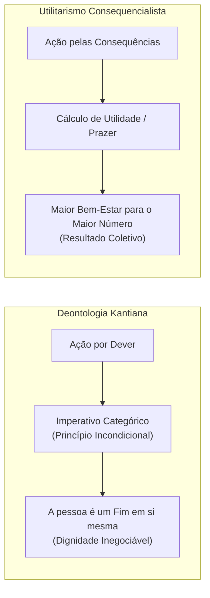

# Semana 3 - Ética na Modernidade: Deontologia Kantiana e Utilitarismo

> **Disciplina:** Ética, Cidadania e Sociedade (SOC100)  
> **Carga Horária:** 40 horas  
> **Bimestre:** 2026S2B1 - Univesp

---

Olá, estudante!

Boas-vindas à **Semana 3** da disciplina **Ética, Cidadania e Sociedade (SOC100)**!

Nesta semana, examinaremos os dois modelos teóricos mais influentes e contrastantes da filosofia moral moderna e contemporânea:

1. **A Deontologia Kantiana (Ética do Dever):** Formulada pelo filósofo alemão **Immanuel Kant** (*Fundamentação da Metafísica dos Costumes*). Para Kant, o valor moral de uma ação reside estritamente no motivo do **dever** e na **boa vontade**, orientados pelo **Imperativo Categórico**. Os seres humanos possuem **dignidade** intrínseca e jamais podem ser tratados como meros instrumentos para fins alheios.
2. **O Utilitarismo (Ética Consequencialista):** Desenvolvido pelos filósofos britânicos **Jeremy Bentham** e **John Stuart Mill**. O utilitarismo sustenta que a retidão moral de um ato é julgada unicamente pelas suas **consequências**, buscando sempre a *"maior quantidade de felicidade e bem-estar para o maior número possível de indivíduos"*.

---

## 🎯 Objetivos de aprendizagem

Ao final desta semana, você deverá ser capaz de:

- Compreender a revolução moral do Iluminismo e a fundamentação racional da ética autônoma;
- Analisar os conceitos kantianos de **Boa Vontade**, **Dever**, **Imperativo Categórico** e a distinção entre **Preço** e **Dignidade**;
- Explicar os princípios do **Utilitarismo Clássico** (Bentham e Stuart Mill) e o cálculo consequencialista de utilidade;
- Contrastar as abordagens deontológica (baseada em princípios/deveres incondicionais) e teleológica/consequencialista;
- Aplicar essas teorias na análise de dilemas éticos complexos da sociedade contemporânea (como carros autônomos e triagem hospitalar).

---

## ⚖️ Deontologia vs Utilitarismo

---

## 🧩 Desafio da Semana: O Dilema do Veículo Autônomo e a Tomada de Decisão Algorítmica

Considere a programação do software de controle de um **carro autônomo**:  
*Diante de uma falha inesperada nos freios e uma colisão inevitável, o algoritmo do carro precisa escolher em milissegundos entre:*
- *Opção A:* Manter a trajetória e atropelar 5 pedestres que atravessam a faixa;
- *Opção B:* Desviar bruscamente em direção a um poste, sacrificando a vida do único passageiro a bordo para salvar os 5 pedestres.

**Questões para Reflexão:**
1. Como um comitê de ética fundamentado no **Utilitarismo de Jeremy Bentham** justificaria a programação do carro para a Opção B?
2. Por que, sob a ótica do **Imperativo Categórico de Immanuel Kant**, utilizar a vida do passageiro como mero instrumento de cálculo matemático violaria o princípio da dignidade da pessoa humana?

---

## 🎥 Material-base: Videoaulas

### 🎬 Videoaula 5 - Immanuel Kant: O Dever e o Imperativo Categórico
* **Docente Responsável:** Prof. Dr. Sílvio Gallo / Equipe Univesp
* **Tema:** Autonomia moral, imperativo hipotético vs categórico e o reino dos fins.
* **Resumo:** Apresentação da ética kantiana como a busca por princípios racionais universalizáveis, destacando a máxima: *"Age de tal modo que trates a humanidade sempre como um fim e nunca apenas como um meio"*.

### 🎬 Videoaula 6 - O Utilitarismo: Bentham, Stuart Mill e o Consequencialismo
* **Docente Responsável:** Equipe Univesp
* **Tema:** Princípio da utilidade, cálculo hedônico e o bem-estar coletivo.
* **Resumo:** Discussão sobre a maximização do prazer e redução da dor, analisando os limites e os desafios do utilitarismo diante dos direitos individuais inalienáveis.

---

## 📚 Leituras Recomendadas

* **Texto-base 1:** *Fundamentação da Metafísica dos Costumes* (Immanuel Kant). Ver resumo em [`1-Texto-base.md`](file:///home/henrique/Modelos/Univesp/2026S2B1/SOC100-Etica-Cidadania-e-Sociedade/Semana-3/1-Texto-base.md).
* **Texto-base 2:** *O Utilitarismo* (John Stuart Mill). Ver resumo em [`2-Texto-base.md`](file:///home/henrique/Modelos/Univesp/2026S2B1/SOC100-Etica-Cidadania-e-Sociedade/Semana-3/2-Texto-base.md).
