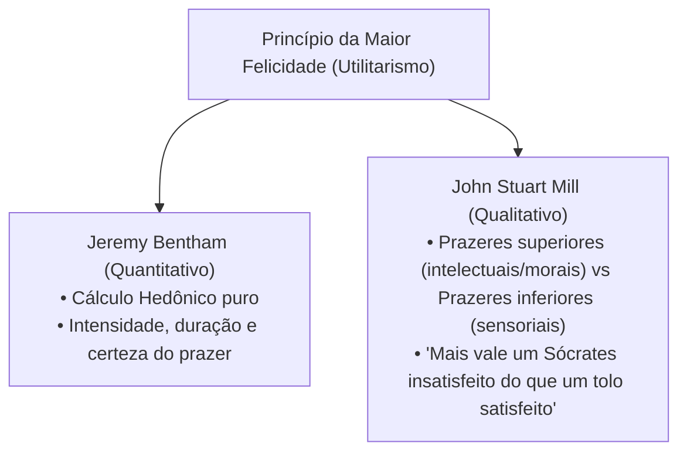

# 2 - Texto-base: O Utilitarismo e o Princípio da Maior Felicidade (Bentham & Mill)

> **Obras de Referência:** *Uma Introdução aos Princípios da Moral e da Legislação* (Jeremy Bentham) e *O Utilitarismo* (John Stuart Mill)  
> **Tradução:** Coleção Os Pensadores

---

## 📖 O Princípio da Máxima Utilidade

O **Utilitarismo** é a corrente ética consequencialista mais expressiva da modernidade. Seu princípio fundamental afirma que:
> *"As ações são corretas na medida em que tendem a promover a felicidade, e erradas na medida em que tendem a produzir o inverso da felicidade."*

---

## 🔍 Tabela Comparativa: Deontologia Kantiana vs Utilitarismo

| Critério de Comparação | Deontologia Kantiana | Utilitarismo (Bentham / Mill) |
| :--- | :--- | :--- |
| **Critério Moral** | A intenção / O respeito ao dever e à lei moral. | O resultado / As consequências práticas da ação. |
| **Natureza dos Princípios** | Imperativos categóricos absolutos e inegociáveis. | Flexíveis, calculados conforme a maximização do bem-estar. |
| **Status da Pessoa** | A pessoa é um fim em si mesma (possui dignidade). | O indivíduo conta como uma unidade no cálculo coletivo de utilidade. |
| **Exemplo de Dilema** | Mentir é sempre moralmente errado, mesmo para salvar uma vida. | Mentir é moralmente correto se o resultado líquido produzir mais felicidade do que sofrimento. |
