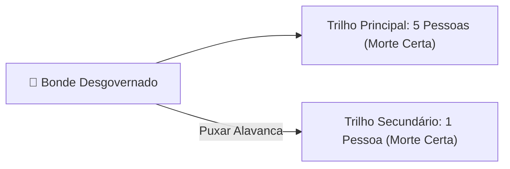

# 4 - Aprofundando o Tema: O Problema do Bonde (*Trolley Problem*) na Era da Inteligência Artificial

> **Tema:** O Problema do Bonde e a Ética de Algoritmos Autônomos  
> **Autoras de Referência:** Philippa Foot e Judith Jarvis Thomson / Experimento *Moral Machine* (MIT)

---

## 🚋 O Dilema Clássico do Bonde

Em 1967, a filósofa Philippa Foot propôs um dos experimentos mentais mais célebres da ética contemporânea:
- Um bonde desgovernado avança pelos trilhos em direção a cinco operários.
- Você está ao lado de uma alavanca. Se puxar a alavanca, o bonde desviará para um trilho secundário, onde há apenas um operário.

---

## 🤖 A Transposição para Veículos Autônomos e IA

O que era um exercício teórico de filosofia transformou-se em um problema prático urgente para engenheiros de software e formuladores de políticas públicas com a chegada dos **carros autônomos**:
- **A Abordagem Utilitarista:** Programa o veículo para minimizar o número total de vítimas a qualquer custo matemático (salvar 5 vidas ao custo de 1).
- **A Abordagem Deontológica / Direitos:** Argumenta que programar um carro para ativamente escolher matar o seu próprio passageiro (ou um pedestre inocente na calçada) transforma uma pessoa em mero escudo instrumental, violando seu direito fundamental à vida.

O projeto **Moral Machine do MIT** coletou mais de 40 milhões de decisões em 233 países, revelando fortes variações culturais sobre quais escolhas a sociedade considera aceitáveis.
