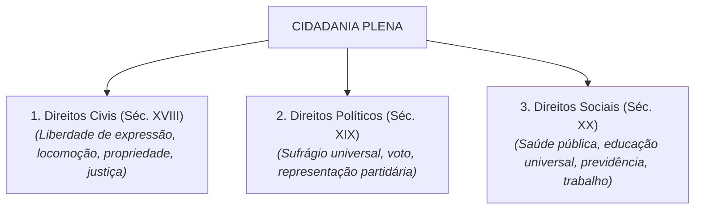

# Semana 4 - Cidadania, Direitos e a Constituição Cidadã

> **Disciplina:** Ética, Cidadania e Sociedade (SOC100)  
> **Carga Horária:** 40 horas  
> **Bimestre:** 2026S2B1 - Univesp

---

Olá, estudante!

Boas-vindas à **Semana 4** da disciplina **Ética, Cidadania e Sociedade (SOC100)**!

Nesta semana, transicionaremos da reflexão ética estritamente moral para a dimensão política e jurídica da **Cidadania**. 

Ser cidadão não significa apenas ter um documento de identidade ou votar a cada dois anos. A cidadania é uma conquista histórica permanente, fruto de lutas e tensões sociais pelo reconhecimento de direitos e deveres.

Estudaremos a clássica tipologia do sociólogo britânico **T. H. Marshall**, que divide a cidadania em três dimensões sucessivas:
1. **Direitos Civis (Século XVIII):** Liberdade individual, de expressão, de locomoção e igualdade perante a lei;
2. **Direitos Políticos (Século XIX):** Direito de votar, ser votado e participar do poder político;
3. **Direitos Sociais (Século XX):** Educação, saúde, previdência, trabalho digno e segurança social.

Também analisaremos a singularidade da construção da cidadania no Brasil, culminando na promulgação da **Constituição Federal de 1988** (*A Constituição Cidadã*), sob a perspectiva do historiador **Jaime Pinsky**.

---

## 🎯 Objetivos de aprendizagem

Ao final desta semana, você deverá ser capaz de:

- Definir o conceito de cidadania e compreender sua historicidade;
- Identificar e caracterizar as três dimensões de direitos segundo T. H. Marshall (Civis, Políticos e Sociais);
- Compreender a trajetória histórica da cidadania no Brasil (do período colonial e escravocrata à redemocratização);
- Analisar os avanços civilizatórios e as garantias fundamentais da Constituição Federal de 1988;
- Refletir sobre a distância entre a cidadania formal (inscrita na lei) e a cidadania real (vivenciada pela população).

---

## 🏛️ A Tríade dos Direitos de T. H. Marshall

---

## 🧩 Desafio da Semana: A Efetivação dos Direitos Fundamentais no Brasil

Considere o Artigo 6º da Constituição de 1988:  
> *"São direitos sociais a educação, a saúde, a alimentação, o trabalho, a moradia, o transporte, o lazer, a segurança, a previdência social, a proteção à maternidade e à infância, a assistência aos desamparados..."*

**Questões para Reflexão:**
1. Qual é a principal diferença entre os conceitos de **cidadania formal** (o texto legal) e **cidadania real** (o cotidiano das periferias brasileiras)?
2. Por que, segundo Jaime Pinsky, a cidadania no Brasil foi frequentemente concedida de "cima para baixo" pelo Estado (cidadania regulada), em vez de conquistada por forte mobilização popular autônoma?
3. Qual é o papel da universidade pública e dos profissionais de tecnologia na redução das desigualdades de acesso à cidadania plena?

---

## 🎥 Material-base: Videoaulas

### 🎬 Videoaula 7 - A Construção Histórica da Cidadania: T. H. Marshall
* **Docente Responsável:** Equipe Univesp
* **Tema:** Direitos civis, políticos e sociais na modernidade ocidental.
* **Resumo:** Apresentação da evolução cronológica da cidadania na Inglaterra e Europa Ocidental, destacando a ampliação progressiva do corpo de cidadãos.

### 🎬 Videoaula 8 - Cidadania no Brasil e a Constituição de 1988
* **Docente Responsável:** Prof. Jaime Pinsky / Equipe Univesp
* **Tema:** Da escravidão à redemocratização e os desafios da Constituição Cidadã.
* **Resumo:** O historiador Jaime Pinsky discute as marcas do passado autoritário brasileiro e o marco histórico da Carta de 1988 como garantidora de direitos humanos e sociais.

---

## 📚 Leituras Recomendadas

* **Texto-base 1:** *Cidadania, Classe Social e Status* (T. H. Marshall). Ver resumo em [`1-Texto-base.md`](file:///home/henrique/Modelos/Univesp/2026S2B1/SOC100-Etica-Cidadania-e-Sociedade/Semana-4/1-Texto-base.md).
* **Texto-base 2:** *História da Cidadania* (Jaime Pinsky e Carla Bassanezi Pinsky, Editora Contexto). Ver resumo em [`2-Texto-base.md`](file:///home/henrique/Modelos/Univesp/2026S2B1/SOC100-Etica-Cidadania-e-Sociedade/Semana-4/2-Texto-base.md).
