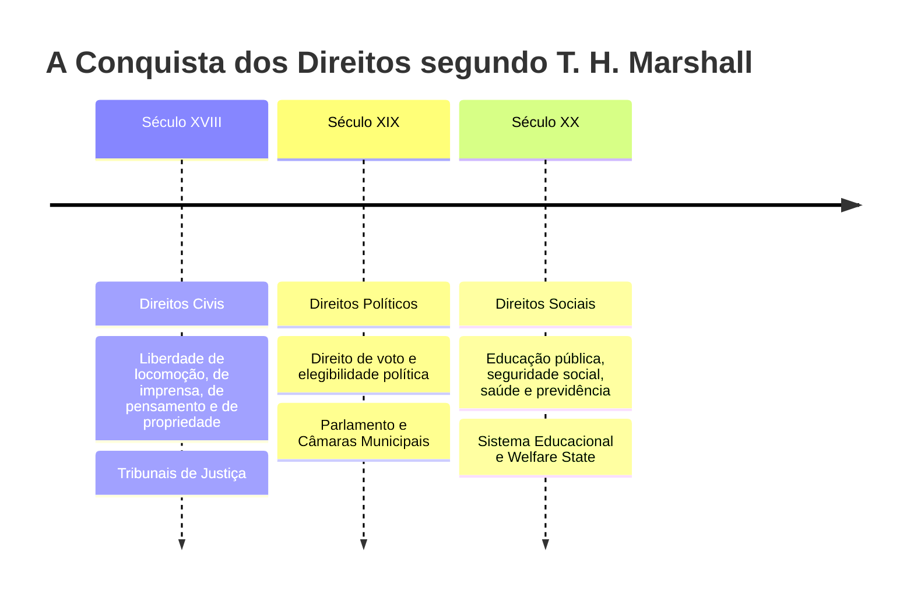

# 1 - Texto-base: Cidadania, Classe Social e Status (T. H. Marshall)

> **Obra:** *Citizenship and Social Class* (1950)  
> **Autor:** Thomas Humphrey Marshall (1893–1981)  
> **Editora:** Zahar Editores

---

## 📖 A Evolução da Cidadania em Três Séculos

T. H. Marshall formulou o modelo canônico de compreensão da cidadania moderna, dividindo-a em três elementos constitutivos:

---

## 🔍 Tensão entre Capitalismo e Cidadania

A tese central de Marshall reside na tensão permanente entre dois polos:
- **O Mercado Capitalista:** Gera desigualdades materiais inevitáveis através da divisão do trabalho e da renda.
- **A Cidadania:** Busca impor a igualdade básica de status fundamental entre todos os membros da comunidade.

Os **direitos sociais** funcionam como o amortecedor dessa tensão, assegurando que nenhum cidadão fique excluído do padrão mínimo de vida civilizada decorrente de carências econômicas extremas.
